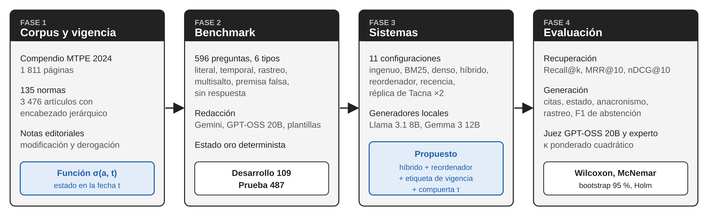
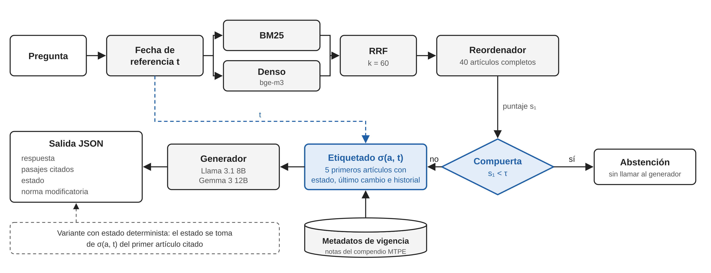

# Benchmark temporal y RAG con restricción de vigencia para pregunta-respuesta sobre normas laborales peruanas

*A temporal-aware benchmark and validity-constrained RAG for Spanish-language statutory QA: the case of Peruvian labor law*

> Borrador v1. Lo marcado con ⟦…⟧ depende de la validación humana pendiente (κ entre anotadores y juez-experto).

**Abstract.** Retrieval-augmented generation (RAG) for legal questions usually assumes that every retrieved provision is in force, an assumption that fails for statutes that are amended and repealed over time. We present a temporal-aware benchmark of 596 Spanish questions over 135 Peruvian private-sector labor norms, covering literal, temporal, amendment-tracing, multi-hop, false-premise and unanswerable questions, with validity states derived deterministically from the editorial notes of the official compendium. We also propose a validity-constrained RAG that annotates each retrieved article with its state at the date implied by the question and abstains below a threshold calibrated on a development split. On 487 test questions, a hybrid retriever with reranking reached nDCG@10 of 0.812, against 0.614 for a replica of a metadata-aware legal RAG on the same corpus, whose LLM-extracted filters discarded the correct article in most temporal questions. Without validity metadata, generators answered «in force» in 78–93 % of questions about provisions that were not. Small open generators (Llama 3.1 8B, Gemma 3 12B) used the validity line to trace amendments (0.76–0.82 vs 0.11–0.13) but ignored it when stating validity; taking the state from the deterministic function raised state accuracy from 0.28 to 0.51 and cut anachronisms from 0.69 to 0.38 (McNemar, Holm-adjusted p < 10⁻⁸). The abstention gate raised abstention F1 from 0.31 to 0.71. An LLM judge proved insensitive to temporal validity, which supports deterministic temporal metrics.

**Keywords:** retrieval-augmented generation, legal question answering, temporal validity, benchmark, abstention, spanish, labor law

---

## I. Introducción

La generación aumentada por recuperación (RAG) condiciona la respuesta de un modelo de lenguaje a pasajes recuperados de un corpus externo y reduce la dependencia de lo memorizado en sus parámetros [1]. En el ámbito jurídico se ha aplicado a quejas civiles en Corea con 1 039 respuestas de expertos [2], a legislación del Reino Unido con reducción de alucinaciones de 34.8 % a 5.2 % [3] y a jurisprudencia en amárico con 500 pares evaluados [4]. Estos sistemas comparten un supuesto: que todo pasaje recuperado sigue rigiendo. Manoharan y Athuraliya llaman «ceguera temporal» a la incapacidad de distinguir entre normas vigentes, modificadas y derogadas, y la señalan como el principal riesgo del RAG legal en sistemas jurídicos que cambian [5].

Las normas legales tienen una estructura que el troceado genérico rompe. Su significado se reparte entre ley, capítulo, artículo y disposiciones, y un fragmento aislado pierde el calificativo que lo gobierna [6]. Además, las normas se versionan: una misma disposición tiene redacciones sucesivas, y SAT-Graph RAG propone separar la obra abstracta de cada una de sus expresiones fechadas [7]. ViHERMES muestra que, en regulación sanitaria vietnamita, buena parte de las preguntas reales exige seguir enmiendas y remisiones entre normas [8].

El problema técnico central es que la similitud semántica no codifica la vigencia. Los recuperadores densos devuelven evidencia desactualizada cuando conviven varias versiones de un mismo hecho [9], y los conjuntos de prueba temporales, como ChronoQA con 5 176 preguntas, confirman que los sistemas RAG fallan en consultas con anclaje explícito o implícito en el tiempo [10]. Las soluciones publicadas castigan la antigüedad del documento con una distancia en años [11] o con funciones de decaimiento aprendidas [12], lo que en derecho es incorrecto: una norma de 1997 puede estar plenamente vigente y una de 2019 puede estar derogada. Por otro lado, AbstentionBench encontró en 20 modelos que abstenerse ante preguntas sin respuesta o con premisa falsa sigue sin resolverse y que el ajuste para razonar lo empeora en 24 % [13].

En el Perú, cerca de siete de cada diez trabajadores son informales, con 70.9 % al cierre de 2024 según el Instituto Nacional de Estadística e Informática (INEI) [14], y la Superintendencia Nacional de Fiscalización Laboral (SUNAFIL) atendió 56 837 denuncias laborales solo en el primer semestre de 2025 [15]. La normativa del régimen privado está dispersa en más de un centenar de leyes, decretos y reglamentos que el Ministerio de Trabajo y Promoción del Empleo (MTPE) reúne en un compendio de 1 811 páginas con notas de modificación y derogación [16]. Jove-Ticona et al. construyeron sobre ese compendio, el general y el de regímenes especiales, un RAG con herencia de metadatos y filtros extraídos por un modelo de lenguaje, y reportaron mejoras de 13.10 % a 28.15 % en cuatro métricas de RAGAS frente a un RAG ingenuo, con 150 pares pregunta-respuesta validados manualmente [17]; los propios autores declaran la vigencia normativa como limitación.

Los asistentes basados en modelos de lenguaje traen riesgos conocidos en este dominio. Inventan citas o artículos cuando la evidencia es débil [3], y su evaluación suele descansar en un modelo juez cuya fiabilidad depende del diseño y de la validación con humanos [18]. NitiBench, con dos conjuntos tailandeses, halló que los componentes jurídicos específicos mejoran poco a los métodos ingenuos y que los recuperadores aún fallan en consultas legales complejas [19], lo que obliga a medir la recuperación con métricas objetivas y no solo con puntajes de un juez.

El objetivo de este trabajo fue construir un benchmark temporal de pregunta-respuesta sobre la normativa laboral peruana del régimen privado y un RAG que etiqueta de forma determinista la vigencia de cada artículo recuperado en la fecha de la consulta, y compararlo con líneas base ingenua, léxica, densa, híbrida, por recencia y la arquitectura de Tacna [17]. Se plantearon cuatro preguntas: ¿cuánto fallan los RAG actuales en preguntas temporales (RQ1)?, ¿supera el etiquetado determinista de vigencia a la penalización por recencia (RQ2)?, ¿cuánto aporta cada componente (RQ3)? y ¿concuerda el juez automático con expertos (RQ4)?

---

## II. Estado del arte

La búsqueda se hizo en Scopus con términos sobre RAG legal, pregunta-respuesta temporal, abstención y evaluación de RAG, para 2024–2026. De 99 registros se descartaron los que no trataban RAG o QA (lógica difusa, imágenes médicas, bases de datos) y se retuvieron 31 que se agrupan en cuatro ejes: RAG sobre normas estructuradas, vigencia y tiempo, benchmarks legales y abstención, y evaluación. Ninguno de los 99 resúmenes trabaja con español ni con normativa latinoamericana. La Tabla I resume los trabajos más cercanos.

**Tabla I.** Trabajos relacionados

| Ref. | Ámbito y datos | Método | Validación | Resultado clave | Temporal | Abstención | Español |
|---|---|---|---|---|---|---|---|
| [5] Apofasi | Sri Lanka, leyes y precedentes; 320 consultas | Grafo temporal y máscara temporal determinista | Precisión temporal, exactitud de citas | 0.97 y 0.96, supera a vectorial, decaimiento y grafo | Sí | No | No |
| [7] SAT-Graph RAG | Normas genéricas | Grafo ontológico obra/expresión | Cualitativa por trazas | Resuelve consultas de procedencia | Sí | No | No |
| [20] TaxFlow | India, tributario | Híbrido denso-disperso, filtro de vigencia | Métricas automáticas | 96.5 % de exactitud | Sí | No | No |
| [6] Smart Indexing | India, Income Tax Act | Metadatos jerárquicos en cada trozo, padre-hijo | Comparación con troceado | Mejora de contexto | No | No | No |
| [21] LawRAG | Indonesia | Troceado por título, artículo y párrafo, reranker | Exactitud | Supera al troceado secuencial | No | No | No |
| [17] Tacna | Perú, laboral; 150 preguntas | Herencia de metadatos, filtros por LLM, reranker | RAGAS, prueba t con n = 12 | +13.10 % a +28.15 % sobre RAG ingenuo | No | No | Sí |
| [19] NitiBench | Tailandia, financiero y tributario | Comparación RAG y contexto largo | Métricas propias | Componentes jurídicos mejoran poco | No | No | No |
| [8] ViHERMES | Vietnam, salud | Benchmark multisalto con grafo | QA multisalto | Incluye rastreo de enmiendas | Parcial | No | No |
| [22] Rustamov | Azerbaiyán, tributario | BM25 + bge-m3 + reranker | Recall@100, nDCG | Recall 0.49 → 0.60, nDCG 0.39 → 0.44 | No | No | No |
| [2] Kim y Lee | Corea, 1 039 quejas reales | 12 configuraciones RAG | Recall@200, nDCG@20, juez | Mejor recuperación no siempre mejora la respuesta | No | No | No |
| [9] Re3 | Noticias, clima | Codificador temporal y filtro de recencia | Re2 Bench, 1.3 M instancias | Supera a líneas base | Sí, recencia | No | No |
| [11] ESG temporal | Reportes ESG, 200 consultas | Reranking por distancia en años | p por consulta, d de Cohen | 78.0 % frente a 62.5 % | Sí, recencia | No | No |
| [10] ChronoQA | Noticias chinas, 5 176 preguntas | Benchmark | Tipología temporal | Tipos absolutos, agregados y relativos | Sí | No | No |
| [13] AbstentionBench | 20 conjuntos, 20 LLM | Benchmark de abstención | Recall de abstención | Razonar reduce la abstención 24 % | Parcial | Sí | No |
| [23] Confidence-gated | Oncología, 62 preguntas | Reranker con compuerta de confianza | Alucinación | Reduce alucinaciones | No | Sí | No |
| [24] Qwen3 Kazajistán | 63 114 pares ruso-kazajo | LoRA | BERTScore, expertos a ciegas | κ ponderado 0.80–0.95 | No | No | No |
| Este trabajo | Perú, laboral; 3 476 artículos, 596 preguntas | Híbrido + reranker + etiqueta determinista de vigencia + compuerta | Recall@k, nDCG, estado, citas, F1 de abstención, juez validado | nDCG@10 0.812; anacronismo 0.90 → 0.38; F1 abst. 0.31 → 0.71 | Sí | Sí | Sí |

### A. RAG sobre normas estructuradas

Bati et al. inyectan en cada fragmento los metadatos de ley, capítulo, sección y título, y expanden de fragmentos pequeños a su sección padre para reconstruir el contexto [6]. LawRAG segmenta las normas indonesias por título, artículo y párrafo, y con un reranker supera al troceado secuencial [21]. Rustamov et al. compararon BM25, SPLADE y tres modelos densos sobre el código tributario de Azerbaiyán; la fusión de BM25 con bge-m3 elevó el recall@100 de 0.49 a 0.60 y el reranker subió el nDCG de 0.39 a 0.44 [22], resultado que replica Giang et al. en derecho vietnamita [25]. Tacna aplica la misma idea de herencia de metadatos al derecho laboral peruano [17]. Ninguno de estos trabajos considera si el artículo recuperado regía en la fecha de la consulta.

### B. Vigencia y tiempo en RAG

Apofasi combina un planificador agéntico con un grafo de conocimiento temporal y una máscara determinista de vigencia; en 320 consultas obtuvo precisión temporal de 0.97 y exactitud de citas de 0.96 [5]. SAT-Graph RAG formaliza las versiones de una norma, aunque solo lo evalúa con trazas cualitativas [7], y TaxFlow filtra disposiciones tributarias por fecha de efecto [20]. Fuera del derecho, Re3 suprime versiones obsoletas con un filtro de recencia [9], ChronoReflect+ itera recuperación y reflexión [26], Truong ordena por distancia en años y reporta 78.0 % de exactitud temporal frente a 62.5 % del sistema semántico [11], y Chronofy aprende un decaimiento exponencial [12]. Los enfoques por recencia suponen que lo nuevo reemplaza a lo viejo; ninguno se probó en español ni con normas cuya vigencia se documenta en notas de modificación.

### C. Benchmarks legales, temporales y de abstención

NitiBench evaluó RAG y modelos de contexto largo en dos conjuntos tailandeses [19], ViHERMES cubre preguntas multisalto con rastreo de enmiendas [8] y LEXTIME mide el ordenamiento temporal de eventos en demandas estadounidenses [27]. ChronoQA [10] y COMPLEXTEMPQA [28] ofrecen tipologías temporales sobre noticias y Wikidata. AbstentionBench reúne preguntas sin respuesta, con premisa falsa y con información desactualizada [13], y FalseCoTQA inserta cadenas de razonamiento falsas en contextos multisalto [29]. Deroy et al. encontraron que los modelos generan sobre todo preguntas de recordar y comprender [30], lo que justifica mezclar preguntas generadas con plantillas deterministas y validación humana. No hay un benchmark que combine estos tipos para normas en español.

### D. Evaluación de RAG

Kim y Lee relacionaron recall@200 y nDCG@20 con la consistencia de la respuesta mediante regresión logística [2], y Trappolini et al. muestran que las métricas clásicas no predicen bien la utilidad para el modelo [31]. RAGVUE descompone la evaluación en recuperación, completitud, fidelidad y calibración del juez [32], y el estudio de Gu et al. advierte que un juez automático necesita validarse contra humanos y no coincidir con el generador [18]. Yeleussinov et al. reportan κ ponderado entre dos expertos de 0.80 a 0.95 [24]. Tacna, en cambio, no declara el juez ni reporta métricas de recuperación [17].

### E. Síntesis y brecha

La Tabla I muestra tres vacíos. El primero es lingüístico: ningún trabajo con evaluación temporal usa normas en español. El segundo es metodológico: los sistemas temporales para documentos genéricos usan recencia, que no equivale a vigencia, y los sistemas legales con vigencia (Apofasi, TaxFlow) no publican un benchmark con preguntas sin respuesta y premisa falsa. El tercero es de evaluación: el antecedente peruano compara solo contra un RAG ingenuo, sin estadística por pregunta ni métricas objetivas. Este trabajo cubre los tres en una escala acotada. No construye un grafo de conocimiento ni recupera redacciones antiguas, que el compendio no contiene; para fechas anteriores a una modificación el sistema advierte en lugar de responder con el texto histórico.

---

## III. Materiales y métodos

### A. Tipo y diseño de la investigación

Es una investigación aplicada, de tipo tecnológico, con enfoque cuantitativo y diseño experimental comparativo. La unidad de análisis es la pregunta del benchmark; cada sistema responde las mismas preguntas, lo que permite comparaciones pareadas.

### B. Metodología

El trabajo siguió cuatro fases: construcción del corpus con metadatos de vigencia, construcción y validación del benchmark, implementación de sistemas y líneas base, y evaluación (Fig. 1). Las semillas aleatorias, los modelos y los comandos están en el repositorio para reproducir cada tabla.

**Fig. 1.** Fases de la investigación: corpus con metadatos de vigencia, benchmark, sistemas y evaluación.

### C. Corpus y requerimientos

El corpus es el compendio de normas laborales del régimen privado del MTPE actualizado al 21 de octubre de 2024 [16], uno de los tres compendios que usó Tacna junto con la Constitución [17], con 1 811 páginas. Un analizador propio reconoce el índice (tipo, número, fecha y tema de cada norma), los encabezados de artículo y disposición, las sumillas y las notas de cambio que el compendio inserta tras cada artículo modificado, incorporado o derogado. De cada nota se extraen la acción, la norma que la produjo y su fecha. El resultado tiene 135 normas, 3 476 artículos y disposiciones, y 678 notas con fecha y norma: 477 modificaciones, 165 incorporaciones y 36 derogaciones. Hay 430 artículos modificados y 25 derogados (Tabla II).

**Tabla II.** Composición del corpus

| Indicador | Valor |
|---|---|
| Normas | 135 |
| Artículos y disposiciones | 3 476 |
| Caracteres | 2.89 M |
| Notas de cambio con fecha y norma | 678 |
| Artículos vigentes sin cambios / modificados / derogados | 3 021 / 430 / 25 |

Los sistemas corren localmente en una GPU RTX 5080 de 16 GB. Se usaron bge-m3 [33] para embeddings, jina-reranker-v2-base-multilingual como reordenador, all-MiniLM-L6-v2 para la réplica de Tacna y dos generadores de pesos abiertos servidos con Ollama, Llama 3.1 8B y Gemma 3 12B, con temperatura 0, semilla 7 y contexto de 12 288 tokens; GPT-OSS 20B redactó parte de las preguntas y actúa de juez (Tabla III).

**Tabla III.** Tecnologías

| Componente | Herramienta |
|---|---|
| Embeddings | BAAI/bge-m3 (fp16), all-MiniLM-L6-v2 |
| Reordenador | jinaai/jina-reranker-v2-base-multilingual |
| Léxico | BM25 propio sobre scipy.sparse |
| Generadores evaluados | Llama 3.1 8B, Gemma 3 12B (Ollama) |
| Redacción de preguntas | Gemini 3.5 Flash (literal y temporal), GPT-OSS 20B (multisalto, premisa falsa y sin respuesta), plantillas (rastreo) |
| Juez | GPT-OSS 20B, distinto de los generadores evaluados |
| Estadística | SciPy |

### D. Metadatos de vigencia

Cada artículo *a* tiene tres fechas: *e(a)*, desde cuándo existe; *v(a)*, desde cuándo rige su redacción actual; y *d(a)*, desde cuándo está derogado, si lo está. *e(a)* es la fecha de la nota que lo incorporó, o la publicación de su norma si no hay nota; *v(a)* es la fecha de la última modificación; *d(a)* es la fecha de la nota de derogación del artículo completo. El estado de *a* en una fecha *t* es

$$
\sigma(a,t)=\begin{cases}\text{no\_existía} & t<e(a)\\ \text{derogado} & t\ge d(a)\\ \text{sin\_versión} & e(a)\le t<v(a)\\ \text{vigente} & \text{en otro caso}\end{cases}\tag{1}
$$

donde «sin_versión» indica que el artículo existía pero con una redacción que el compendio no conserva.

### E. Arquitectura del sistema propuesto

La Fig. 2 muestra el flujo. La fecha de referencia *t* se extrae de la pregunta con expresiones regulares que reconocen fechas completas y años entre 1950 y 2049, y que descartan los años que forman parte del número de una norma («D.S. 003-97-TR», «Ley 29783»); si no hay fecha, *t* es el día de la consulta y para un año suelto se toma el 1 de julio. Cada artículo se divide en fragmentos de 250 tokens con traslape de 30, y cada fragmento lleva su encabezado jerárquico (norma, título, capítulo, artículo y sumilla). La recuperación híbrida une el ranking denso y el de BM25 [34] por fusión recíproca [35]:

$$
\mathrm{RRF}(a)=\sum_{r\in\{\text{denso},\,\text{BM25}\}}\frac{1}{k+\mathrm{rank}_r(a)}\tag{2}
$$

donde rank_r(a) es la posición del primer fragmento del artículo *a* en el ranking *r* y *k* = 60. Los 40 primeros artículos se reordenan con el cross-encoder sobre el texto completo del artículo, que funciona como expansión al padre. Los cinco primeros pasan al generador, cada uno con una línea que declara σ(a,t) según (1), la norma y fecha del último cambio y su historial. El artículo no vigente no se elimina: permanece como evidencia rotulada, porque una pregunta con premisa falsa o de rastreo necesita justamente ese artículo.

**Fig. 2.** Arquitectura del sistema propuesto. En azul, los componentes que añade al híbrido con reordenamiento; en línea discontinua, la variante con estado determinista.

La compuerta de abstención evita llamar al generador cuando la evidencia es débil:

$$
\text{abstener}\iff s_1<\tau\tag{3}
$$

donde *s₁* es el puntaje del reranker del primer artículo y τ es el umbral que maximiza el F1 de abstención en la partición de desarrollo. El generador devuelve un objeto JSON con la respuesta, los números de pasaje citados, el estado (vigente, sin_versión, no_existía, derogado, premisa_falsa o fuera_corpus), la abstención y la norma modificatoria cuando corresponde.

### F. Líneas base

Se compararon once configuraciones de recuperación (Tabla IV). La línea base por recencia sigue a Truong [11] y penaliza el puntaje del reranker con la distancia entre el año de la redacción y la fecha de referencia:

$$
s'(a)=s(a)-\lambda\frac{|y_t-y_{v(a)}|}{36}\tag{4}
$$

donde *y_t* es el año de referencia (o el actual), *y_v(a)* el año de *v(a)*, 36 normaliza por el rango de años del corpus y λ = 0.15. La réplica de Tacna reproduce su código público [17]: corrección ortográfica y extracción de filtros (artículo, norma, año) con Llama 3.1 8B, relajación de filtros, 15 fragmentos densos y reordenamiento a cinco.

**Tabla IV.** Sistemas evaluados

| Sistema | Descripción |
|---|---|
| ingenuo | Fragmentos de 1 000 caracteres con traslape de 200, sin estructura, bge-m3 |
| bm25 | BM25 sobre fragmentos con encabezado |
| denso | bge-m3 sobre fragmentos con encabezado |
| denso_sin_cabecera | bge-m3 sobre fragmentos sin encabezado (ablación) |
| híbrido | RRF de denso y BM25 |
| híbrido_rr | híbrido + reranker sobre el artículo completo |
| híbrido_rr_trozos | híbrido + reranker sobre fragmentos, sin expansión al padre (ablación) |
| tacna_minilm / tacna_bge | Réplica de Tacna con MiniLM o bge-m3 |
| recencia | híbrido_rr + penalización (4) |
| propuesto | híbrido_rr + etiqueta de vigencia (1) + compuerta (3) |

### G. Benchmark

El benchmark sigue las proporciones de la propuesta: literal 20 %, temporal 20 %, rastreo de modificaciones 15 %, multisalto 15 %, premisa falsa 15 % y sin respuesta 15 %, con 596 preguntas. Los artículos se muestrearon de forma estratificada por tema. Gemini 3.5 Flash redactó las preguntas literales, con 30 % que citan la norma y el artículo, y las temporales; la cuota gratuita de 20 peticiones diarias obligó a redactar el resto con GPT-OSS 20B en local. En las temporales la fecha y el estado esperado se fijan de forma determinista con (1) y el modelo solo redacta el enunciado. Las de rastreo se arman con plantillas a partir de la última nota de cambio, sin modelo. En las de premisa falsa por dato alterado, el código extrae una cifra del artículo («30 días»), la altera («45 días») y el modelo redacta una pregunta que la da por cierta; se descartan las que no contienen la cifra falsa. Las de premisa falsa por derogación tratan como vigente uno de los artículos derogados. Las multisalto parten de pares de artículos unidos por una remisión explícita («conforme al artículo 16», «el Decreto Supremo N.° 001-97-TR»). Las preguntas sin respuesta tratan regímenes especiales, sector público, pensiones o tributos que el compendio no cubre. Cada pregunta guarda su respuesta de referencia, los artículos de oro, el estado esperado, la fecha de referencia y si debe abstenerse. Las preguntas se dividieron en desarrollo (20 %) y prueba (80 %) con un hash del identificador; τ y las decisiones de diseño se fijaron solo con desarrollo.

Dos anotadores revisaron una muestra estratificada de 120 preguntas, 20 por tipo, marcando si la pregunta es válida y si el estado de referencia es correcto; el acuerdo se mide con κ de Cohen [36].

### H. Métricas

Para una pregunta con conjunto de artículos de oro *G* y ranking *R*:

$$
\mathrm{Recall@}k=\frac{|G\cap R_{1..k}|}{|G|},\qquad \mathrm{MRR@}10=\frac{1}{\mathrm{rank}_1}\tag{5}
$$

$$
\mathrm{nDCG@}10=\frac{\sum_{i\le 10,\,R_i\in G}1/\log_2(i+1)}{\sum_{i=1}^{\min(|G|,10)}1/\log_2(i+1)}\tag{6}
$$

donde rank₁ es la posición del primer artículo de oro (MRR = 0 si pasa de 10). En multisalto se reporta además Todos@10, la proporción de preguntas con todos sus artículos de oro en los diez primeros. Para la respuesta, con *C* el conjunto de artículos citados:

$$
P_{cita}=\frac{|C\cap G|}{|C|},\qquad R_{cita}=\frac{|C\cap G|}{|G|}\tag{7}
$$

La exactitud de estado es la proporción de preguntas temporales y de premisa falsa en que el estado devuelto coincide con el esperado, y la tasa de anacronismo es la proporción de preguntas cuyo estado esperado no es «vigente» y el sistema respondió «vigente». El rastreo es correcto si la respuesta nombra la norma modificatoria. Para la abstención:

$$
F1_{abs}=\frac{2PR}{P+R}\tag{8}
$$

donde *P* es la proporción de abstenciones que debían ocurrir y *R* la proporción de preguntas sin respuesta en que el sistema se abstuvo. Un juez (GPT-OSS 20B en local, distinto de los dos generadores evaluados) califica la corrección de 0 a 2 frente a la respuesta de referencia y la fidelidad de 0 a 1 respecto de los pasajes, en una muestra estratificada de 20 preguntas por tipo. Un experto calificó 100 de esas respuestas con la misma escala y el acuerdo se mide con κ ponderado cuadrático:

$$
\kappa_w=1-\frac{\sum_{i,j}w_{ij}o_{ij}}{\sum_{i,j}w_{ij}e_{ij}},\qquad w_{ij}=\frac{(i-j)^2}{(n-1)^2}\tag{9}
$$

donde *o_ij* y *e_ij* son las proporciones observadas y esperadas de la celda (i, j) y *n* = 3 niveles.

### I. Diseño de la evaluación

Todas las comparaciones son pareadas por pregunta en la partición de prueba. Las métricas continuas (nDCG@10) se comparan con la prueba de rangos con signo de Wilcoxon y un intervalo de confianza bootstrap al 95 % con 10 000 remuestreos; las binarias (estado correcto) con McNemar exacto. Los valores p se ajustan con Holm por familia de comparaciones. Se registran la latencia por consulta, los tokens y las llamadas al modelo de cada sistema. El análisis de errores clasifica los fallos del sistema propuesto con la matriz de confusión de estados.

---

## IV. Resultados

### A. Benchmark y acuerdo entre anotadores

El benchmark final tiene 596 preguntas (Tabla V): 109 de desarrollo y 487 de prueba. Hay cuatro preguntas multisalto menos que la cuota, porque el modelo no devolvió una pregunta válida para esos pares. Entre las temporales, 50 piden una fecha en que la redacción actual aún no regía, 20 una fecha anterior a la existencia del artículo y 50 una fecha en que la redacción sí regía. Siete preguntas de premisa falsa tratan como vigente un artículo derogado, que son todos los derogados con texto suficiente, y 83 alteran una cifra. ⟦κ entre anotadores cuando se completen las hojas de validación.⟧

**Tabla V.** Composición del benchmark

| Tipo | Total | Prueba | Redacción |
|---|---|---|---|
| Literal | 120 | 98 | Gemini |
| Temporal | 120 | 98 | Gemini, estado determinista |
| Rastreo | 90 | 79 | Plantilla |
| Multisalto | 86 | 69 | GPT-OSS 20B |
| Premisa falsa | 90 | 70 | GPT-OSS 20B, cifra alterada en código |
| Sin respuesta | 90 | 73 | GPT-OSS 20B |
| Total | 596 | 487 | |

### B. Recuperación

La Tabla VI resume la recuperación en las 414 preguntas de prueba que tienen artículos de oro. El híbrido con reordenamiento alcanzó nDCG@10 de 0.812 y Recall@5 de 0.880. La réplica de Tacna obtuvo 0.614 con bge-m3 y 0.417 con MiniLM, y el RAG ingenuo, 0.489. Recencia y propuesto no difieren del híbrido con reordenamiento en recuperación: el propuesto usa el mismo ranking y solo agrega la etiqueta de vigencia, y la penalización por recencia movió el nDCG@10 en −0.006 (IC 95 % [−0.016, 0.003], p Holm = 1.00).

**Tabla VI.** Recuperación en la partición de prueba (n = 414)

| Sistema | Hit@1 | Recall@5 | Recall@10 | MRR@10 | nDCG@10 | Todos@10 | s/consulta |
|---|---|---|---|---|---|---|---|
| Recencia | 0.734 | 0.880 | 0.914 | 0.813 | 0.818 | 0.638 | 0.157 |
| Híbrido + reordenador | 0.713 | 0.880 | 0.914 | 0.803 | 0.812 | 0.638 | 0.166 |
| Propuesto | 0.713 | 0.880 | 0.914 | 0.803 | 0.812 | 0.638 | 0.159 |
| Híbrido + reordenador de fragmentos | 0.710 | 0.877 | 0.913 | 0.801 | 0.809 | 0.623 | 0.188 |
| Denso | 0.594 | 0.760 | 0.812 | 0.683 | 0.699 | 0.609 | 0.007 |
| Híbrido | 0.585 | 0.755 | 0.822 | 0.676 | 0.695 | 0.594 | 0.008 |
| BM25 | 0.488 | 0.707 | 0.789 | 0.602 | 0.632 | 0.580 | 0.004 |
| Tacna (bge-m3) | 0.577 | 0.646 | 0.664 | 0.628 | 0.614 | 0.507 | 0.999 |
| Denso sin encabezado | 0.505 | 0.684 | 0.727 | 0.599 | 0.612 | 0.507 | 0.008 |
| Ingenuo | 0.353 | 0.571 | 0.650 | 0.461 | 0.489 | 0.449 | 0.040 |
| Tacna (MiniLM) | 0.420 | 0.420 | 0.434 | 0.440 | 0.417 | 0.174 | 1.023 |

Por tipo de pregunta (Tabla VII), la mayor diferencia aparece en las temporales: Tacna recuperó el artículo correcto entre los cinco primeros en 6.1 % de los casos con bge-m3 y en 3.1 % con MiniLM, frente a 91.8 % del híbrido con reordenamiento. En 109 de las 120 preguntas temporales el extractor de Tacna convirtió el año de la pregunta en un filtro sobre el año de publicación de la norma, lo que descarta el artículo vigente cuando la norma es de otro año. En rastreo, el encabezado jerárquico explica casi toda la diferencia: el denso sin encabezado llegó a 0.114 de Recall@5 y el denso con encabezado a 0.405.

**Tabla VII.** Recall@5 por tipo de pregunta

| Sistema | Literal | Temporal | Rastreo | Multisalto | Premisa falsa |
|---|---|---|---|---|---|
| Híbrido + reordenador / propuesto | 0.969 | 0.918 | 0.873 | 0.746 | 0.843 |
| Recencia | 0.949 | 0.918 | 0.911 | 0.746 | 0.829 |
| Híbrido | 0.827 | 0.867 | 0.532 | 0.717 | 0.786 |
| Denso | 0.908 | 0.949 | 0.405 | 0.703 | 0.743 |
| Denso sin encabezado | 0.878 | 0.908 | 0.114 | 0.681 | 0.743 |
| BM25 | 0.663 | 0.755 | 0.671 | 0.703 | 0.743 |
| Tacna (bge-m3) | 0.888 | 0.061 | 0.886 | 0.688 | 0.814 |
| Tacna (MiniLM) | 0.510 | 0.031 | 0.835 | 0.377 | 0.414 |
| Ingenuo | 0.806 | 0.755 | 0.101 | 0.558 | 0.529 |

La Tabla VIII compara el nDCG@10 del híbrido con reordenamiento contra cada sistema con la prueba de Wilcoxon. Todas las diferencias con el ingenuo, BM25, el denso, el híbrido sin reordenar y ambas réplicas de Tacna son significativas tras Holm (p < 10⁻⁷). La expansión al artículo completo no mejoró el reordenamiento por fragmentos (Δ = 0.002, p Holm = 0.069).

**Tabla VIII.** Diferencia de nDCG@10 frente a híbrido + reordenador (Wilcoxon, IC bootstrap 95 %, Holm)

| Sistema | Δ media | IC 95 % | p Holm |
|---|---|---|---|
| Tacna (MiniLM) | 0.395 | [0.347, 0.442] | 3.6 × 10⁻³⁶ |
| Ingenuo | 0.323 | [0.285, 0.361] | 1.3 × 10⁻³⁹ |
| Denso sin encabezado | 0.200 | [0.164, 0.237] | 1.1 × 10⁻¹⁹ |
| Tacna (bge-m3) | 0.198 | [0.156, 0.242] | 4.0 × 10⁻¹⁴ |
| BM25 | 0.180 | [0.147, 0.214] | 2.6 × 10⁻¹⁹ |
| Híbrido | 0.117 | [0.086, 0.150] | 1.5 × 10⁻⁸ |
| Denso | 0.113 | [0.082, 0.144] | 6.6 × 10⁻¹⁰ |
| Híbrido + reordenador de fragmentos | 0.002 | [−0.011, 0.015] | 0.069 |
| Recencia | −0.006 | [−0.016, 0.003] | 1.00 |

El umbral de abstención calibrado en desarrollo fue τ = 0.368, con F1 de abstención de 0.743 en esa partición.

### C. Generación, vigencia y abstención

La Tabla IX resume la generación sobre las 487 preguntas de prueba con los dos generadores. Las cifras de estado y anacronismo se calculan sobre las 168 preguntas temporales y de premisa falsa, y el rastreo sobre las de su tipo. Todas las salidas fueron JSON válido.

**Tabla IX.** Generación por sistema y generador (partición de prueba, n = 487)

| Sistema | Generador | P cita | R cita | Estado ok | Anacronismo ↓ | Rastreo ok | F1 abst. | s/resp. | Tokens |
|---|---|---|---|---|---|---|---|---|---|
| Ingenuo | Llama 3.1 8B | 0.353 | 0.377 | 0.333 | 0.852 | 0.013 | 0.138 | 1.7 | 1 794 |
| Híbrido + reordenador | Llama 3.1 8B | 0.622 | 0.659 | 0.298 | 0.898 | 0.114 | 0.300 | 1.8 | 1 990 |
| Recencia | Llama 3.1 8B | 0.632 | 0.671 | 0.286 | 0.930 | 0.089 | 0.365 | 1.9 | 2 113 |
| Tacna (MiniLM) | Llama 3.1 8B | 0.365 | 0.351 | 0.226 | 0.547 | 0.038 | 0.327 | 1.3 | 1 123 |
| Tacna (bge-m3) | Llama 3.1 8B | 0.498 | 0.511 | 0.304 | 0.578 | 0.038 | 0.174 | 1.4 | 1 299 |
| Propuesto | Llama 3.1 8B | 0.657 | 0.687 | 0.280 | 0.688 | 0.759 | 0.709 | 1.6 | 1 787 |
| Propuesto, estado determinista | Llama 3.1 8B | 0.657 | 0.687 | **0.506** | **0.375** | 0.759 | 0.709 | 1.6 | 1 787 |
| Ingenuo | Gemma 3 12B | 0.360 | 0.374 | 0.268 | 0.781 | 0.038 | 0.380 | 7.4 | 1 638 |
| Híbrido + reordenador | Gemma 3 12B | 0.637 | 0.673 | 0.256 | 0.875 | 0.127 | 0.531 | 6.9 | 1 820 |
| Tacna (bge-m3) | Gemma 3 12B | 0.464 | 0.478 | 0.125 | 0.477 | 0.038 | 0.278 | 5.7 | 1 194 |
| Propuesto | Gemma 3 12B | **0.668** | **0.715** | 0.333 | 0.516 | **0.823** | 0.703 | 7.2 | 1 683 |
| Propuesto, estado determinista | Gemma 3 12B | **0.668** | **0.715** | **0.464** | **0.359** | **0.823** | 0.703 | 7.2 | 1 683 |

Los sistemas sin metadatos de vigencia respondieron «vigente» en 78 % a 93 % de las preguntas cuyo artículo estaba derogado, no existía o tenía otra redacción en la fecha consultada. La recencia fue la peor en este indicador (0.930), pese a empatar con el mejor sistema en recuperación. Tacna redujo el anacronismo a 0.547–0.578, pero porque recuperó menos artículos y se abstuvo más, no porque identificara el estado: su exactitud de estado (0.125–0.304) no supera al RAG ingenuo.

El sistema propuesto multiplicó el rastreo correcto por más de seis (0.759 y 0.823 frente a 0.114 y 0.127 del híbrido con reordenamiento) y elevó el F1 de abstención a 0.70–0.71. Sin embargo, con el estado elegido por el generador la exactitud de estado no difirió de la línea base con Llama (0.280 frente a 0.298, p Holm = 1.00) y mejoró poco con Gemma (0.333 frente a 0.256, p Holm = 0.048). El análisis de las salidas mostró que los generadores ignoran la etiqueta aunque esté en el contexto: con Llama, el artículo de oro con estado «sin_versión» llegó al contexto en 38 de 41 casos y el modelo respondió «vigente» en 31.

Por ello se evaluó una variante, definida después de observar ese resultado, que conserva la respuesta textual del generador pero toma el estado de σ(a, t) para el primer artículo citado (o el primero del contexto), salvo cuando el generador declara premisa falsa, fuera de corpus o se abstiene. Con esta variante la exactitud de estado subió a 0.506 con Llama y 0.464 con Gemma, y el anacronismo bajó a 0.375 y 0.359. La mejora fue significativa frente a todas las líneas base y frente al estado del propio generador con ambos modelos (McNemar exacto, p Holm ≤ 1.3 × 10⁻³). En las preguntas temporales la variante acertó el estado en 74.5 % (Llama) y 70.4 % (Gemma). El error restante se concentra en las premisas falsas con cifra alterada: los generadores las detectaron en 6 y 4 de 64 casos y en el resto respondieron con el estado del artículo o se abstuvieron. Las seis premisas falsas de prueba sobre artículos derogados se resolvieron por el estado determinista.

**Tabla X.** Exactitud de estado del propuesto con estado determinista frente a cada sistema (McNemar exacto, Holm, n = 168)

| Comparación | Llama 3.1 8B | p Holm | Gemma 3 12B | p Holm |
|---|---|---|---|---|
| Ingenuo | 0.506 vs 0.333 | 1.3 × 10⁻³ | 0.464 vs 0.268 | 6.0 × 10⁻⁶ |
| Híbrido + reordenador | 0.506 vs 0.298 | 2.0 × 10⁻⁵ | 0.464 vs 0.256 | 1.1 × 10⁻⁶ |
| Recencia | 0.506 vs 0.286 | 1.4 × 10⁻⁵ | — | — |
| Tacna (MiniLM) | 0.506 vs 0.226 | 1.1 × 10⁻⁶ | — | — |
| Tacna (bge-m3) | 0.506 vs 0.304 | 7.3 × 10⁻⁴ | 0.464 vs 0.125 | 1.4 × 10⁻¹⁰ |
| Propuesto, estado del generador | 0.506 vs 0.280 | 4.1 × 10⁻⁹ | 0.464 vs 0.333 | 6.0 × 10⁻⁶ |

### D. Ablación

La Tabla XI reúne las ablaciones. En recuperación, el encabezado jerárquico aporta 0.087 de nDCG@10 al denso (0.699 frente a 0.612) y casi toda la recuperación en rastreo; el reordenador aporta 0.117 sobre el híbrido; y la expansión al artículo completo no difiere del reordenamiento por fragmentos (Δ = 0.002, p Holm = 0.069). En generación con Llama, quitar la línea de vigencia del contexto hizo caer el rastreo de 0.759 a 0.114 y la precisión de citas de 0.657 a 0.564, sin cambiar la exactitud de estado del generador (0.274 frente a 0.280), lo que confirma que el modelo usa la línea para nombrar la norma modificatoria pero no para fijar el estado. Quitar la compuerta bajó el F1 de abstención de 0.709 a 0.308 (recall de abstención de 0.836 a 0.192) y casi triplicó la latencia, porque el generador recibe contexto en las preguntas sin respuesta.

**Tabla XI.** Ablación de componentes

| Componente retirado | Métrica | Con | Sin |
|---|---|---|---|
| Encabezado jerárquico (denso) | nDCG@10 | 0.699 | 0.612 |
| Encabezado jerárquico (denso) | Recall@5 en rastreo | 0.405 | 0.114 |
| Reordenador (híbrido) | nDCG@10 | 0.812 | 0.695 |
| Expansión al artículo | nDCG@10 | 0.812 | 0.809 |
| Línea de vigencia (Llama) | Rastreo ok | 0.759 | 0.114 |
| Línea de vigencia (Llama) | P cita | 0.657 | 0.564 |
| Compuerta τ (Llama) | F1 abstención | 0.709 | 0.308 |
| Compuerta τ (Llama) | s/resp. | 1.6 | 4.5 |
| Estado determinista (Llama) | Exactitud de estado | 0.506 | 0.280 |

### E. Juez automático y concordancia con experto

El juez calificó 1 197 respuestas: 120 por corrida en diez corridas, salvo tres respuestas del RAG ingenuo con Llama que no devolvió. Las notas fueron casi binarias (576 con 2, 529 con 0 y 92 con 1). El sistema propuesto obtuvo la mayor corrección con ambos generadores (Tabla XII), con diferencias de 0.25 a 0.36 en la escala normalizada frente a cada línea base, todas significativas (Wilcoxon, p Holm ≤ 3.1 × 10⁻⁷ con Gemma y ≤ 2.5 × 10⁻⁵ con Llama). La ventaja se concentra en rastreo (0.62–0.80 frente a 0.00–0.07) y en sin respuesta (0.60–0.95 frente a 0.00–0.30); en literales y multisalto todos los sistemas superan 0.70, salvo Tacna con MiniLM en literales.

**Tabla XII.** Juez automático, corrección normalizada (0–1) y fidelidad (n = 120 por corrida)

| Sistema | Generador | Corrección | Totalmente correcta | Fidelidad |
|---|---|---|---|---|
| Ingenuo | Llama 3.1 8B | 0.449 | 0.410 | 0.463 |
| Híbrido + reordenador | Llama 3.1 8B | 0.442 | 0.425 | 0.476 |
| Recencia | Llama 3.1 8B | 0.446 | 0.408 | 0.521 |
| Tacna (MiniLM) | Llama 3.1 8B | 0.433 | 0.375 | 0.428 |
| Tacna (bge-m3) | Llama 3.1 8B | 0.412 | 0.333 | 0.427 |
| Propuesto | Llama 3.1 8B | **0.696** | **0.667** | **0.681** |
| Ingenuo | Gemma 3 12B | 0.533 | 0.492 | 0.559 |
| Híbrido + reordenador | Gemma 3 12B | 0.487 | 0.467 | 0.537 |
| Tacna (bge-m3) | Gemma 3 12B | 0.467 | 0.425 | 0.476 |
| Propuesto | Gemma 3 12B | **0.829** | **0.808** | **0.826** |

El juez fue poco sensible a la vigencia. En preguntas temporales calificó al RAG ingenuo con Gemma (0.78) y a Tacna con MiniLM (0.85) por encima del propuesto (0.62–0.70), aunque esos sistemas tienen las peores tasas de anacronismo o de exactitud de estado de la Tabla IX. Esto indica que un juez basado en modelo premia la respuesta que coincide con la redacción actual y no verifica la fecha consultada, de modo que las métricas deterministas de estado son necesarias y no sustituibles por el juez. La concordancia con un experto humano se mide sobre 100 respuestas exportadas para calificación a ciegas ⟦κ ponderado cuando se complete la hoja⟧.

### F. Comparación con la literatura

La Tabla XIII sitúa los resultados frente a los trabajos más cercanos. Las cifras no son directamente comparables porque los corpus, las preguntas y las métricas difieren; la comparación indica órdenes de magnitud y qué se midió en cada caso.

**Tabla XIII.** Comparación con la literatura

| Indicador | Este trabajo | Literatura | Observación |
|---|---|---|---|
| Exactitud de estado o precisión temporal | 0.745 en temporales, 0.506 global (Llama, estado determinista) | 0.97 [5] | [5] usa grafo temporal curado y 320 consultas; aquí se incluyen premisas falsas con cifra alterada |
| Mejora por señal temporal | +0.207 de exactitud de estado sobre híbrido + reordenador | 78.0 % frente a 62.5 % [11] | En leyes la recencia no mejora el estado (0.286 frente a 0.298) |
| nDCG@10 de recuperación | 0.812 (híbrido + reordenador) | 0.39 → 0.44 [22] | Corpus de 135 normas frente a un código tributario; métrica a profundidad distinta |
| Ganancia sobre RAG ingenuo | nDCG@10 de 0.489 a 0.812 (+66 %) | 13.10–28.15 % en RAGAS [17] | Réplica de [17] sobre el mismo corpus: nDCG@10 de 0.417–0.614 |

Respecto de Apofasi [5], la diferencia principal está en la fuente de los estados: allí provienen de un grafo construido para el estudio, y aquí de las notas editoriales del compendio, que no incluyen la redacción histórica. La réplica de Tacna sobre el mismo corpus y las mismas preguntas permite una comparación directa que la literatura no ofrece: su arquitectura con filtros extraídos por un modelo y bge-m3 mejora la recuperación literal sobre el RAG ingenuo (Recall@5 de 0.888 frente a 0.806), pero cae a 3.1–6.1 % de Recall@5 en preguntas temporales y no mejora la exactitud de estado.

---

## V. Discusión

Los resultados muestran que la recuperación por similitud, por buena que sea, no basta para responder sobre normas que cambian. El híbrido con reordenamiento recupera el artículo correcto entre los cinco primeros en 91.8 % de las preguntas temporales, pero el generador responde «vigente» en 89.8 % de los casos en que el artículo no regía en la fecha consultada. Para un trabajador que pregunta por un despido de 2019, esa respuesta puede citar un plazo o un monto que entonces no existía, y el error no es visible porque la cita es correcta.

La recencia, que funciona en dominios donde lo más nuevo suele ser lo correcto [11], no resuelve este problema en el derecho: empató en recuperación y fue la peor en anacronismo (0.930), porque favorecer la redacción más reciente es justo lo contrario de lo que pide una pregunta sobre el pasado. La vigencia es una relación entre el artículo y una fecha, y por eso se resuelve mejor con una función explícita σ(a, t) que con un peso sobre el puntaje.

La réplica de Tacna aclara qué aporta un filtro de metadatos extraído por un modelo. Sobre preguntas literales mejora al RAG ingenuo, pero el extractor interpreta el año de la pregunta como año de publicación de la norma y elimina el artículo correcto en casi todas las temporales. Un filtro duro decidido por un modelo pequeño es frágil: cuando se equivoca, el generador no ve la evidencia. En el sistema propuesto la fecha solo anota el estado de cada artículo y no retira pasajes del contexto.

El hallazgo más relevante es que los generadores pequeños no usan la etiqueta de vigencia para fijar el estado. Lo hacen para nombrar la norma modificatoria (el rastreo sube de 0.114 a 0.759 al agregar la línea) y para abstenerse, pero no para cambiar «vigente» por «sin_versión». Tomar el estado de σ(a, t) en lugar del generador sube la exactitud de estado en 0.13 a 0.23 sin costo adicional, lo que sugiere separar en el diseño lo que debe decidir una regla (el estado) de lo que debe redactar el modelo (la explicación). Esta variante se definió después de observar el fallo y debe confirmarse en un conjunto nuevo.

La compuerta de abstención fue la pieza de mejor costo-beneficio: con un umbral calibrado en desarrollo elevó el F1 de abstención de 0.308 a 0.709 y redujo la latencia, porque las preguntas fuera del corpus no llegan al generador. Las premisas falsas con cifra alterada siguen sin resolverse: ningún componente compara la cifra de la pregunta con la del artículo, y los generadores la detectaron en menos del 10 % de los casos. El sistema propuesto añade una llamada al reordenador y ninguna al modelo de lenguaje respecto del híbrido, frente a las dos llamadas extra por consulta de Tacna (corrector y extractor).

**Limitaciones y amenazas a la validez.** El compendio solo trae la redacción vigente, de modo que el sistema advierte («sin_versión») pero no reproduce el texto histórico. Las fechas de vigencia salen de notas editoriales del MTPE y el analizador puede omitir notas con formato irregular. La mayoría de preguntas se generó con modelos y luego se validó por muestreo, lo que favorece enunciados cercanos al texto del artículo [30]; no hay aún consultas reales de trabajadores. Dos modelos distintos redactaron las preguntas por el límite diario de la cuota gratuita de Gemini, y GPT-OSS 20B redactó tres tipos y actúa de juez, aunque es distinto de los generadores evaluados. Solo seis premisas falsas de prueba tratan artículos derogados, porque el compendio tiene pocos derogados con texto. La variante con estado determinista se definió tras observar los resultados de prueba. Ollama procesa en paralelo varias solicitudes y eso puede alterar levemente las salidas aun con temperatura 0 y semilla fija. El juez es poco sensible a la vigencia y su concordancia con el experto está pendiente. La réplica de Tacna sigue su código público, pero su conjunto de 150 preguntas no está publicado.

---

## VI. Conclusiones y trabajo futuro

Se presentó un benchmark de 596 preguntas sobre 135 normas laborales peruanas, con seis tipos de pregunta y estados de vigencia calculados de forma determinista desde el compendio del MTPE, y un RAG que anota cada artículo con su estado en la fecha de la pregunta y se abstiene bajo un umbral calibrado. Frente a la réplica de Tacna sobre el mismo corpus, el híbrido con reordenamiento elevó el nDCG@10 de 0.614 a 0.812, y el sistema propuesto con estado determinista redujo el anacronismo de 0.578 a 0.375, multiplicó el rastreo de modificaciones de 0.038 a 0.759 y elevó el F1 de abstención de 0.174 a 0.709 con Llama 3.1 8B, con resultados similares con Gemma 3 12B. Los generadores pequeños ignoran la etiqueta de vigencia al fijar el estado, por lo que este debe decidirlo una regla y no el modelo.

Como trabajo futuro se propone recuperar versiones históricas desde ediciones anteriores del compendio o del SPIJ para responder con el texto que regía, incorporar consultas reales de trabajadores con apoyo de SUNAFIL o de consultorios jurídicos, verificar cifras de la pregunta contra el artículo para las premisas falsas, construir un grafo de remisiones para el multisalto, completar la validación con dos anotadores y un experto, y extender el benchmark a otros regímenes laborales.

---

## Referencias

[1] P. Lewis *et al.*, «Retrieval-augmented generation for knowledge-intensive NLP tasks», en *Advances in Neural Information Processing Systems*, vol. 33, 2020, pp. 9459–9474.

[2] Y. Kim y W. Lee, «Where does legal AI fail? Evaluating RAG pipelines», en *Proc. 34th ACM Int. Conf. Information and Knowledge Management (CIKM)*, 2025, pp. 1396–1405, doi: 10.1145/3746252.3761151.

[3] K. Shahzad, E. Udoh, P. Pryce y A. Ul Haq, «Domain-specific legal AI assistant with retrieval-augmented generation (RAG)», en *Int. Conf. Artificial Intelligence, Systems, and Emerging Technologies (ICAISET)*, 2026, doi: 10.1109/ICAISET66439.2026.11541312.

[4] E. Desalegn *et al.*, «Improving Amharic legal question answering with retrieval-augmented generation and locally-sourced data», *Knowledge-Based Systems*, vol. 346, art. 116194, 2026, doi: 10.1016/j.knosys.2026.116194.

[5] S. Manoharan y B. Athuraliya, «Apofasi: A neuro-symbolic temporal RAG framework for evolving mixed legal systems», en *IEEE Symp. Computer Applications and Industrial Electronics (ISCAIE)*, 2026, doi: 10.1109/ISCAIE68866.2026.11576429.

[6] V. S. Bati, C. B. Abhigna, S. H. Sindhya y R. Kalpa, «Mitigating context loss in legal RAG: A metadata-aware chunking strategy for hierarchical Indian statutes», en *Proc. 4th IEEE Int. Conf. Knowledge Engineering and Communication Systems (ICKECS)*, 2026, doi: 10.1109/ICKECS70176.2026.11528014.

[7] H. de Martim, «An ontology-driven graph RAG for legal norms: A hierarchical, temporal, and deterministic approach», *Frontiers in Artificial Intelligence and Applications*, vol. 416, pp. 282–287, 2025, doi: 10.3233/FAIA251598.

[8] L. S. T. Nguyen *et al.*, «ViHERMES: A graph-grounded multihop question answering benchmark and system for Vietnamese healthcare regulations», *Lecture Notes in Computer Science*, vol. 16530, pp. 321–336, 2026, doi: 10.1007/978-981-92-0071-9_22.

[9] J. Cao *et al.*, «Re3: Relevance & recency retrieval for mitigating temporal hallucination», en *Proc. Annual Meeting of the Association for Computational Linguistics (ACL)*, vol. 1, 2026, pp. 25735–25760, doi: 10.18653/v1/2026.acl-long.1180.

[10] Z. Chen *et al.*, «A question answering dataset for temporal-sensitive retrieval-augmented generation», *Scientific Data*, vol. 12, art. 1855, 2025, doi: 10.1038/s41597-025-06098-y.

[11] A. K. N. Truong, «Temporal-aware RAG for multilingual ESG document retrieval: A low-resource approach to time-sensitive question answering», en *Proc. IEEE Int. Conf. Big Data*, 2025, pp. 5535–5542, doi: 10.1109/BigData66926.2025.11402566.

[12] M. Syed, M. Silaghi, S. Abujar y S. Akter, «Chronofy: A temporal-logical decay architecture for information validity in time-aware retrieval-augmented generation», en *Proc. IEEE Int. Conf. Information Reuse and Integration for Data Science (IRI)*, 2026, pp. 454–459, doi: 10.1109/IRI69576.2026.00090.

[13] P. Kirichenko, M. Ibrahim, K. Chaudhuri y S. J. Bell, «AbstentionBench: Reasoning LLMs fail on unanswerable questions», en *Advances in Neural Information Processing Systems*, vol. 38, 2025.

[14] V. Lozano Alfaro, «MTPE: “La informalidad es un tema crucial que debemos resolver”», *Agencia Andina*, Lima, 28 abr. 2025. [En línea]. Disponible en: https://andina.pe/agencia/noticia-mtpe-informalidad-es-un-tema-crucial-debemos-resolver-1027516.aspx

[15] Agencia Andina, «Sunafil atendió más de 56,000 denuncias en el primer semestre de 2025», Lima, 29 sep. 2025, con datos del Boletín Semestral 2025-1 de SUNAFIL. [En línea]. Disponible en: https://andina.pe/agencia/noticia-sunafil-atendio-mas-56000-denuncias-el-primer-semestre-2025-1046657.aspx

[16] Ministerio de Trabajo y Promoción del Empleo, *Compendio de normas laborales del régimen laboral privado*, actualizado al 21 oct. 2024, Lima, publicado el 7 ene. 2025. [En línea]. Disponible en: https://www.gob.pe/institucion/mtpe/informes-publicaciones/6359927-compendio-de-normas-laborales-del-regimen-laboral-privado

[17] A. V. Jove-Ticona, L. J. Duarte-Coaquera, I. N. Chaparro-Cruz, S. B. Cabana-Yupanqui y A. Chaparro-Guerra, «A new metadata-aware retrieval-augmented generation (RAG) architecture for trustworthy legal question answering», *International Journal of Advanced Computer Science and Applications*, vol. 17, n.º 8, pp. 741–751, 2026.

[18] J. Gu *et al.*, «A survey on LLM-as-a-judge», *The Innovation*, vol. 7, n.º 6, art. 101253, 2026, doi: 10.1016/j.xinn.2025.101253.

[19] P. Akarajaradwong *et al.*, «NitiBench: Benchmarking LLM frameworks on Thai legal question answering capabilities», en *Proc. Conf. Empirical Methods in Natural Language Processing (EMNLP)*, 2025, pp. 34304–34327, doi: 10.18653/v1/2025.emnlp-main.1739.

[20] V. R. Karna *et al.*, «A hybrid RAG-LLaMA framework for scalable and accurate interpretation of legal texts», *Applied Artificial Intelligence*, vol. 40, n.º 1, art. 2626097, 2026, doi: 10.1080/08839514.2026.2626097.

[21] A. Fadillah, N. Athahirah y K.-T. Lai, «LawRAG: Indonesian legal document retrieval-augmented generation with specialized chunking and reranking strategies», *Data Technologies and Applications*, vol. 60, n.º 2, pp. 330–347, 2026, doi: 10.1108/DTA-03-2025-0195.

[22] Z. Rustamov, M. Gasimzade y S. Rustamov, «Enhancing retrieval and re-ranking in RAG: A case study on tax law», en *Proc. 19th IEEE Int. Conf. Application of Information and Communication Technologies (AICT)*, 2025, doi: 10.1109/AICT67988.2025.11268677.

[23] T. J. Jasmin, N. Rajagopalan y S. Gopal, «Reducing hallucinations in oncology question answering using confidence-gated retrieval-augmented generation», en *Int. Conf. Smart Communication and Sustainable Technologies (ICSCST)*, 2026, pp. 671–678, doi: 10.1109/ICSCST70031.2026.11709521.

[24] A. Yeleussinov *et al.*, «Fine-tuning Qwen3 models for the legal domain of Kazakhstan: A comparative study of LoRA-adapted models for bilingual legal question answering», *Applied Sciences*, vol. 16, n.º 13, art. 6777, 2026, doi: 10.3390/app16136777.

[25] N. T. Giang, T. M. Duc, N. M. Dang y N. T. M. Trang, «Optimizing retrieval strategies for Vietnamese legal RAG systems», *Communications in Computer and Information Science*, vol. 2803, pp. 146–160, 2026, doi: 10.1007/978-3-032-14674-8_9.

[26] Z. Chen *et al.*, «Advancing temporal sensitive question answering through progressive multi-step reflection», en *Proc. 34th ACM Int. Conf. Information and Knowledge Management (CIKM)*, 2025, pp. 425–435, doi: 10.1145/3746252.3761292.

[27] C. Barale, L. Barrett, V. S. Bajaj y M. Rovatsos, «LEXTIME: A benchmark for temporal ordering of legal events», en *Findings of EMNLP 2025*, 2025, pp. 5220–5236, doi: 10.18653/v1/2025.findings-emnlp.280.

[28] R. Gruber, A. Abdallah, M. Färber y A. Jatowt, «COMPLEXTEMPQA: A 100m dataset for complex temporal question answering», en *Proc. EMNLP*, 2025, pp. 9100–9112, doi: 10.18653/v1/2025.emnlp-main.463.

[29] J. Serbanescu, M. A. A. Alavi, F. Ensan y F. Zarrinkalam, «FalseCoTQA: Adversarial multi-hop QA via knowledge-grounded false chains of thought», en *Proc. SIGIR-AP*, 2025, pp. 160–168, doi: 10.1145/3767695.3769494.

[30] A. Deroy, K. Ghosh y S. Ghosh, «Investigating legal question generation using large language models», *Artificial Intelligence and Law*, vol. 34, n.º 3, pp. 775–813, 2026, doi: 10.1007/s10506-025-09452-y.

[31] G. Trappolini, F. Cuconasu, S. Filice, Y. Maarek y F. Silvestri, «Redefining retrieval evaluation in the era of LLMs», en *Proc. EACL*, vol. 1, 2026, pp. 8359–8375, doi: 10.18653/v1/2026.eacl-long.391.

[32] K. Murugaraj, S. Lamsiyah y M. Theobald, «RAGVUE: A diagnostic view for explainable and automated evaluation of retrieval-augmented generation», en *Proc. EACL (System Demonstrations)*, 2026, pp. 512–526, doi: 10.18653/v1/2026.eacl-demo.35.

[33] J. Chen *et al.*, «M3-Embedding: Multi-linguality, multi-functionality, multi-granularity text embeddings through self-knowledge distillation», en *Findings of ACL 2024*, 2024, pp. 2318–2335.

[34] S. Robertson y H. Zaragoza, «The probabilistic relevance framework: BM25 and beyond», *Foundations and Trends in Information Retrieval*, vol. 3, n.º 4, pp. 333–389, 2009.

[35] G. V. Cormack, C. L. A. Clarke y S. Büttcher, «Reciprocal rank fusion outperforms Condorcet and individual rank learning methods», en *Proc. 32nd ACM SIGIR*, 2009, pp. 758–759.

[36] J. Cohen, «A coefficient of agreement for nominal scales», *Educational and Psychological Measurement*, vol. 20, n.º 1, pp. 37–46, 1960.
