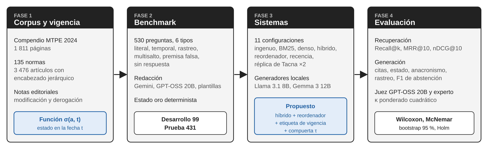
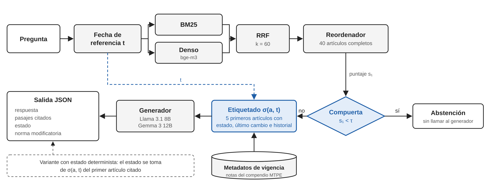

# Benchmark temporal y RAG con restricción de vigencia para pregunta-respuesta sobre normas laborales peruanas

**Abstract.** Retrieval-augmented generation (RAG) for legal questions usually assumes that every retrieved provision is in force, an assumption that fails for statutes that are amended and repealed over time. We present a temporal-aware benchmark of 510 Spanish questions, retained from 596 after removing defective items, over 135 Peruvian private-sector labor norms. It covers literal, temporal, amendment-tracing, multi-hop, false-premise and unanswerable questions, with validity states derived deterministically from the editorial notes of the official compendium. We also propose a validity-constrained RAG that annotates each retrieved article with its state at the date implied by the question and abstains below a threshold calibrated on a development split. On 414 test questions, a hybrid retriever with reranking reached nDCG@10 of 0.835, against 0.611 for a replica of a metadata-aware legal RAG on the same corpus, whose LLM-extracted filters discarded the correct article in most temporal questions. Without validity metadata, generators answered «in force» in 80–94 % of questions about provisions that were not. Small open generators (Llama 3.1 8B, Gemma 3 12B) used the validity line to trace amendments (0.83–0.86 vs 0.13) but ignored it when stating validity; taking the state from the deterministic function raised state accuracy from 0.32 to 0.56 and cut anachronisms from 0.72 to 0.35 with Llama (McNemar, Holm-adjusted p < 10⁻⁷). The abstention gate raised abstention F1 from 0.34 to 0.76. An LLM judge proved insensitive to temporal validity, which supports deterministic temporal metrics.

**Keywords.** retrieval-augmented generation, legal question answering, temporal validity, benchmark, abstention, Spanish, labor law

## I. Introducción

La generación aumentada por recuperación (RAG) hace que un modelo de lenguaje responda a partir de pasajes recuperados de un corpus externo, en lugar de depender solo de lo que memorizó en sus parámetros [1]. En derecho se ha aplicado a quejas civiles en Corea, con 1 039 respuestas de expertos [2], a la legislación del Reino Unido, donde redujo las alucinaciones de 34.8 % a 5.2 % [3], y a jurisprudencia en amárico, con 500 pares evaluados [4]. Estos sistemas suponen que todo pasaje recuperado sigue rigiendo [5]. Manoharan y Athuraliya llaman «ceguera temporal» a la incapacidad de distinguir entre normas vigentes, modificadas y derogadas, y la consideran el principal riesgo del RAG legal cuando el sistema jurídico cambia [5].

El troceado genérico rompe la estructura de las normas. El significado de un artículo se reparte entre la ley, el capítulo y las disposiciones que lo rodean, y un fragmento suelto pierde el calificativo que lo gobierna [6]. Las normas, además, tienen versiones: una misma disposición pasa por redacciones sucesivas, y SAT-Graph RAG propone separar la obra abstracta de cada una de sus expresiones fechadas [7]. En regulación sanitaria vietnamita, ViHERMES encontró que buena parte de las preguntas reales exige seguir enmiendas y remisiones entre normas [8].

La similitud semántica no codifica la vigencia. Cuando conviven varias versiones de un mismo hecho, los recuperadores densos devuelven evidencia desactualizada [9], y conjuntos de prueba como ChronoQA, con 5 176 preguntas, confirman que los RAG fallan en consultas ancladas en el tiempo de forma explícita o implícita [10]. Las soluciones publicadas castigan la antigüedad del documento con una distancia en años [11] o con funciones de decaimiento aprendidas [12]. En derecho ese criterio no sirve, porque la vigencia de una norma depende de las modificaciones y derogaciones posteriores y no de su antigüedad [5], [7]: una norma de 1997 puede estar plenamente vigente y una de 2019, derogada. A esto se suma la abstención. AbstentionBench evaluó 20 modelos y encontró que abstenerse ante preguntas sin respuesta o con premisa falsa sigue sin resolverse, y que el ajuste para razonar la empeora en 24 % [13].

En el Perú, el 70.9 % de los trabajadores era informal al cierre de 2024, según el Instituto Nacional de Estadística e Informática (INEI) [14], y la Superintendencia Nacional de Fiscalización Laboral (SUNAFIL) atendió 56 837 denuncias laborales solo en el primer semestre de 2025 [15]. La normativa del régimen privado está repartida en más de un centenar de leyes, decretos y reglamentos, que el Ministerio de Trabajo y Promoción del Empleo (MTPE) reúne en un compendio de 1 811 páginas con notas de modificación y derogación [16]. Sobre ese compendio y el de regímenes especiales, Jove-Ticona et al. construyeron un RAG con herencia de metadatos y filtros extraídos por un modelo de lenguaje. Frente a un RAG ingenuo reportaron mejoras de 13.10 % a 28.15 % en cuatro métricas de RAGAS, con 150 pares pregunta-respuesta validados a mano, y señalaron la vigencia normativa como limitación [17].

Los asistentes basados en modelos de lenguaje tienen riesgos conocidos en este dominio. Inventan citas o artículos cuando la evidencia es débil [3], y su evaluación suele depender de un modelo juez cuya fiabilidad varía con el diseño y con la validación frente a humanos [18]. NitiBench, con dos conjuntos tailandeses, halló que los componentes jurídicos específicos aportan poco sobre los métodos ingenuos y que los recuperadores todavía fallan en consultas legales complejas [19]. Por eso la recuperación debe medirse con métricas objetivas y no solo con el puntaje de un juez [2], [19].

El objetivo de este trabajo fue construir un benchmark temporal de pregunta-respuesta sobre la normativa laboral peruana del régimen privado [16] y un RAG que etiqueta de forma determinista la vigencia de cada artículo recuperado en la fecha de la consulta. El sistema se comparó con líneas base ingenua, léxica, densa, híbrida y por recencia [11], y con la arquitectura de Tacna [17]. Se plantearon cuatro preguntas: ¿cuánto fallan los RAG actuales en preguntas temporales (RQ1)?, ¿supera el etiquetado determinista de vigencia a la penalización por recencia (RQ2)?, ¿cuánto aporta cada componente (RQ3)? y ¿concuerda el juez automático con un validador independiente (RQ4)?

## II. Estado del arte

La búsqueda se hizo en Scopus para 2024–2026, con términos sobre RAG legal, pregunta-respuesta temporal, abstención y evaluación de RAG. De 99 registros se descartaron los que no trataban RAG ni QA (lógica difusa, imágenes médicas, bases de datos). Quedaron 31, agrupados en cuatro ejes: RAG sobre normas estructuradas, vigencia y tiempo, benchmarks legales y de abstención, y evaluación. Ninguno de los 99 resúmenes trabaja con español ni con normativa latinoamericana. La Tabla I resume los trabajos más cercanos.

**Tabla I.** Trabajos relacionados {ancha}

| Ref. | Ámbito y datos | Método | Validación | Resultado clave | Temporal | Abstención | Español |
|---|---|---|---|---|---|---|---|
| [5] Apofasi | Sri Lanka, leyes y precedentes; 320 consultas | Grafo temporal y máscara temporal determinista | Precisión temporal, exactitud de citas | 0.97 y 0.96, supera a vectorial, decaimiento y grafo | Sí | No | No |
| [7] SAT-Graph RAG | Normas genéricas | Grafo ontológico obra/expresión | Cualitativa por trazas | Resuelve consultas de procedencia | Sí | No | No |
| [20] TaxFlow | India, tributario | Híbrido denso-disperso, filtro de vigencia | Métricas automáticas | 96.5 % de exactitud | Sí | No | No |
| [6] Smart Indexing | India, Income Tax Act | Metadatos jerárquicos en cada trozo, padre-hijo | Comparación con troceado | Mejora de contexto | No | No | No |
| [21] LawRAG | Indonesia | Troceado por título, artículo y párrafo, reranker | Exactitud | Supera al troceado secuencial | No | No | No |
| [17] Tacna | Perú, laboral; 150 preguntas | Herencia de metadatos, filtros por LLM, reranker | RAGAS, prueba t con n = 12 | +13.10 % a +28.15 % sobre RAG ingenuo | No | No | Sí |
| [19] NitiBench | Tailandia, financiero y tributario | Comparación RAG y contexto largo | Métricas propias | Componentes jurídicos mejoran poco | No | No | No |
| [8] ViHERMES | Vietnam, salud | Benchmark multisalto con grafo | QA multisalto | Incluye rastreo de enmiendas | Parcial | No | No |
| [22] Rustamov | Azerbaiyán, tributario | BM25 + bge-m3 + reranker | Recall@100, nDCG | Recall 0.49 → 0.60, nDCG 0.39 → 0.44 | No | No | No |
| [2] Kim y Lee | Corea, 1 039 quejas reales | 12 configuraciones RAG | Recall@200, nDCG@20, juez | Mejor recuperación no siempre mejora la respuesta | No | No | No |
| [9] Re3 | Noticias, clima | Codificador temporal y filtro de recencia | Re2 Bench, 1.3 M instancias | Supera a líneas base | Sí, recencia | No | No |
| [11] ESG temporal | Reportes ESG, 200 consultas | Reranking por distancia en años | p por consulta, d de Cohen | 78.0 % frente a 62.5 % | Sí, recencia | No | No |
| [10] ChronoQA | Noticias chinas, 5 176 preguntas | Benchmark | Tipología temporal | Tipos absolutos, agregados y relativos | Sí | No | No |
| [13] AbstentionBench | 20 conjuntos, 20 LLM | Benchmark de abstención | Recall de abstención | Razonar reduce la abstención 24 % | Parcial | Sí | No |
| [23] Confidence-gated | Oncología, 62 preguntas | Reranker con compuerta de confianza | Alucinación | Reduce alucinaciones | No | Sí | No |
| [24] Qwen3 Kazajistán | 63 114 pares ruso-kazajo | LoRA | BERTScore, expertos a ciegas | κ ponderado 0.80–0.95 | No | No | No |
| Este trabajo | Perú, laboral; 3 476 artículos, 510 preguntas | Híbrido + reranker + etiqueta determinista de vigencia + compuerta | Recall@k, nDCG, estado, citas, F1 de abstención, juez validado | nDCG@10 0.835; anacronismo 0.90 → 0.35; F1 abst. 0.35 → 0.76 | Sí | Sí | Sí |

### A. RAG sobre normas estructuradas

Bati et al. agregan a cada fragmento los metadatos de ley, capítulo, sección y título, y expanden los fragmentos pequeños a su sección padre para reconstruir el contexto [6]. LawRAG segmenta las normas indonesias por título, artículo y párrafo y, con un reranker, supera al troceado secuencial [21]. Rustamov et al. compararon BM25, SPLADE y tres modelos densos sobre el código tributario de Azerbaiyán. La fusión de BM25 con bge-m3 subió el recall@100 de 0.49 a 0.60, y el reranker llevó el nDCG de 0.39 a 0.44 [22]; Giang et al. obtienen un resultado parecido en derecho vietnamita [25]. Tacna lleva la herencia de metadatos al derecho laboral peruano [17]. Ninguno de estos trabajos comprueba si el artículo recuperado regía en la fecha de la consulta.

### B. Vigencia y tiempo en RAG

Apofasi combina un planificador agéntico con un grafo de conocimiento temporal y una máscara determinista de vigencia. En 320 consultas obtuvo 0.97 de precisión temporal y 0.96 de exactitud de citas [5]. SAT-Graph RAG formaliza las versiones de una norma, pero solo lo evalúa con trazas cualitativas [7], y TaxFlow filtra disposiciones tributarias por fecha de efecto [20]. Fuera del derecho, Re3 suprime versiones obsoletas con un filtro de recencia [9] y ChronoReflect+ alterna recuperación y reflexión [26]. Truong ordena por distancia en años y reporta 78.0 % de exactitud temporal, frente a 62.5 % del sistema semántico [11], y Chronofy aprende un decaimiento exponencial [12]. Los enfoques por recencia suponen que lo nuevo reemplaza a lo viejo, y ninguno se probó en español ni con normas cuya vigencia consta en notas de modificación.

### C. Benchmarks legales, temporales y de abstención

NitiBench evaluó RAG y modelos de contexto largo en dos conjuntos tailandeses [19]. ViHERMES cubre preguntas multisalto con rastreo de enmiendas [8], y LEXTIME mide el orden temporal de eventos en demandas estadounidenses [27]. ChronoQA [10] y COMPLEXTEMPQA [28] proponen tipologías temporales sobre noticias y Wikidata. AbstentionBench reúne preguntas sin respuesta, con premisa falsa o con información desactualizada [13], y FalseCoTQA inserta cadenas de razonamiento falsas en contextos multisalto [29]. Deroy et al. observaron que los modelos generan sobre todo preguntas de recordar y comprender [30]; por eso aquí se mezclan preguntas generadas con plantillas deterministas y validación por muestreo. No existe un benchmark que combine estos tipos para normas en español.

### D. Evaluación de RAG

Kim y Lee relacionaron recall@200 y nDCG@20 con la consistencia de la respuesta mediante regresión logística [2]. Trappolini et al. muestran que las métricas clásicas predicen mal la utilidad del pasaje para el modelo [31]. RAGVUE separa la evaluación en recuperación, completitud, fidelidad y calibración del juez [32], y Gu et al. advierten que un juez automático debe validarse contra humanos y no coincidir con el generador [18]. Yeleussinov et al. reportan un κ ponderado de 0.80 a 0.95 entre dos expertos [24]. Tacna no declara qué juez usó ni reporta métricas de recuperación [17].

### E. Síntesis y brecha

De la Tabla I salen tres vacíos. El primero es de idioma: ningún trabajo con evaluación temporal usa normas en español. El segundo es de método: los sistemas temporales para documentos genéricos usan recencia, que no es lo mismo que vigencia, y los sistemas legales con vigencia (Apofasi, TaxFlow) no publican un benchmark con preguntas sin respuesta ni con premisa falsa. El tercero es de evaluación: el antecedente peruano solo se compara con un RAG ingenuo, sin estadística por pregunta ni métricas objetivas. Este trabajo atiende los tres a escala acotada. No construye un grafo de conocimiento ni recupera redacciones antiguas, porque el compendio no las contiene; cuando la fecha consultada es anterior a una modificación, el sistema lo advierte en vez de responder con el texto histórico.

## III. Materiales y métodos

### A. Tipo y diseño de la investigación

La investigación es aplicada, de tipo tecnológico, con enfoque cuantitativo y diseño experimental comparativo. La unidad de análisis es la pregunta del benchmark. Todos los sistemas responden las mismas preguntas, así que las comparaciones son pareadas.

### B. Metodología

El trabajo tuvo cuatro fases (Fig. 1): corpus con metadatos de vigencia, construcción y validación del benchmark, implementación de sistemas y líneas base, y evaluación. Las semillas, los modelos y los comandos para reproducir cada tabla están en el repositorio.

**Fig. 1.** Fases de la investigación: corpus con metadatos de vigencia, benchmark, sistemas y evaluación.

### C. Corpus y requerimientos

El corpus es el compendio de normas laborales del régimen privado del MTPE, actualizado al 21 de octubre de 2024, con 1 811 páginas [16]. Es uno de los tres compendios que usó Tacna, junto con la Constitución [17]. Un analizador propio reconoce el índice (tipo, número, fecha y tema de cada norma), los encabezados de artículo y disposición, las sumillas y las notas que el compendio pone después de cada artículo modificado, incorporado o derogado. De cada nota se extraen la acción, la norma que la produjo y su fecha. Resultan 135 normas, 3 476 artículos y disposiciones y 678 notas con fecha y norma: 477 modificaciones, 165 incorporaciones y 36 derogaciones. Hay 430 artículos modificados y 25 derogados (Tabla II).

**Tabla II.** Composición del corpus

| Indicador | Valor |
|---|---|
| Normas | 135 |
| Artículos y disposiciones | 3 476 |
| Caracteres | 2.89 M |
| Notas de cambio con fecha y norma | 678 |
| Artículos vigentes sin cambios / modificados / derogados | 3 021 / 430 / 25 |

Todo corre en local, en una GPU RTX 5080 de 16 GB. Los embeddings son de bge-m3 [33] y el reordenador es jina-reranker-v2-base-multilingual; la réplica de Tacna usa all-MiniLM-L6-v2. Se evaluaron dos generadores de pesos abiertos servidos con Ollama, Llama 3.1 8B y Gemma 3 12B, con temperatura 0, semilla 7 y contexto de 12 288 tokens. GPT-OSS 20B redactó parte de las preguntas y actúa de juez (Tabla III).

**Tabla III.** Tecnologías

| Componente | Herramienta |
|---|---|
| Embeddings | BAAI/bge-m3 (fp16), all-MiniLM-L6-v2 |
| Reordenador | jinaai/jina-reranker-v2-base-multilingual |
| Léxico | BM25 propio sobre scipy.sparse |
| Generadores evaluados | Llama 3.1 8B, Gemma 3 12B (Ollama) |
| Redacción de preguntas | Gemini 3.5 Flash (literal y temporal), GPT-OSS 20B (multisalto, premisa falsa y sin respuesta), plantillas (rastreo) |
| Juez | GPT-OSS 20B, distinto de los generadores evaluados |
| Validación del benchmark y del juez | Claude Opus 5.5, sin intervenir en redacción, generación ni juicio |
| Estadística | SciPy |

### D. Metadatos de vigencia

Cada artículo *a* tiene tres fechas. *e*(*a*) indica desde cuándo existe: es la fecha de la nota que lo incorporó o, si no hay nota, la de publicación de su norma. *v*(*a*) indica desde cuándo rige su redacción actual y corresponde a la última modificación. *d*(*a*) es la fecha de la nota que deroga el artículo completo, si la hay. El estado de *a* en una fecha *t* es

$$
\sigma(a,t)=\begin{cases}\text{no\_existía} & t<e(a)\\ \text{derogado} & t\ge d(a)\\ \text{sin\_versión} & e(a)\le t<v(a)\\ \text{vigente} & \text{en otro caso}\end{cases}\tag{1}
$$

donde «sin_versión» indica que el artículo existía, pero con una redacción que el compendio no conserva.

### E. Arquitectura del sistema propuesto

La Fig. 2 muestra el flujo. La fecha de referencia *t* sale de la pregunta mediante expresiones regulares que reconocen fechas completas y años entre 1950 y 2049, y que descartan los años incluidos en el número de una norma («D.S. 003-97-TR», «Ley 29783»). Si la pregunta no trae fecha, *t* es el día de la consulta; si trae solo un año, se toma el 1 de julio. Cada artículo se divide en fragmentos de 250 tokens con traslape de 30, y cada fragmento lleva su encabezado jerárquico: norma, título, capítulo, artículo y sumilla. La recuperación híbrida une el ranking denso y el de BM25 [34] por fusión recíproca [35]:

$$
\mathrm{RRF}(a)=\sum_{r\in\{\text{denso},\,\text{BM25}\}}\frac{1}{k+\mathrm{rank}_r(a)}\tag{2}
$$

donde rank~r~(*a*) es la posición del primer fragmento del artículo *a* en el ranking *r* y *k* = 60. Los 40 primeros artículos se reordenan con el cross-encoder sobre el texto completo del artículo, que hace las veces de expansión al padre. Los cinco primeros pasan al generador. Cada uno lleva una línea con su estado σ(*a*, *t*) según (1), la norma y la fecha del último cambio, y su historial. El artículo no vigente no se elimina: queda en el contexto como evidencia rotulada, porque las preguntas con premisa falsa o de rastreo necesitan justamente ese artículo.

 {ancha}

**Fig. 2.** Arquitectura del sistema propuesto. En azul, los componentes que añade al híbrido con reordenamiento; en línea discontinua, la variante con estado determinista.

La compuerta de abstención evita llamar al generador cuando la evidencia es débil:

$$
\text{abstener}\iff s_1<\tau\tag{3}
$$

donde *s*~1~ es el puntaje del reranker para el primer artículo y τ es el umbral que maximiza el F1 de abstención en la partición de desarrollo. El generador devuelve un objeto JSON con la respuesta, los números de pasaje citados, el estado (vigente, sin_versión, no_existía, derogado, premisa_falsa o fuera_corpus), la decisión de abstenerse y, cuando corresponde, la norma modificatoria.

### F. Líneas base

Se compararon once configuraciones de recuperación (Tabla IV). La línea base por recencia sigue a Truong [11] y resta al puntaje del reranker una penalización por la distancia entre el año de la redacción y la fecha de referencia:

$$
s'(a)=s(a)-\lambda\frac{|y_t-y_{v(a)}|}{36}\tag{4}
$$

donde *y*~t~ es el año de referencia (o el actual), *y*~v(a)~ es el año de *v*(*a*), 36 normaliza por el rango de años del corpus y λ = 0.15. La réplica de Tacna sigue su código público [17]: corrección ortográfica y extracción de filtros (artículo, norma y año) con Llama 3.1 8B, relajación de filtros, 15 fragmentos densos y reordenamiento a cinco.

**Tabla IV.** Sistemas evaluados

| Sistema | Descripción |
|---|---|
| ingenuo | Fragmentos de 1 000 caracteres con traslape de 200, sin estructura, bge-m3 |
| bm25 | BM25 sobre fragmentos con encabezado |
| denso | bge-m3 sobre fragmentos con encabezado |
| denso_sin_cabecera | bge-m3 sobre fragmentos sin encabezado (ablación) |
| híbrido | RRF de denso y BM25 |
| híbrido_rr | híbrido + reranker sobre el artículo completo |
| híbrido_rr_trozos | híbrido + reranker sobre fragmentos, sin expansión al padre (ablación) |
| tacna_minilm / tacna_bge | Réplica de Tacna con MiniLM o bge-m3 |
| recencia | híbrido_rr + penalización (4) |
| propuesto | híbrido_rr + etiqueta de vigencia (1) + compuerta (3) |

### G. Benchmark

El benchmark sigue las proporciones de la propuesta: literal 20 %, temporal 20 %, rastreo de modificaciones 15 %, multisalto 15 %, premisa falsa 15 % y sin respuesta 15 %. Antes de depurar tenía 596 preguntas. Los artículos se muestrearon de forma estratificada por tema. Gemini 3.5 Flash redactó las literales, de las que 30 % citan la norma y el artículo, y las temporales; la cuota gratuita de 20 peticiones diarias obligó a redactar el resto con GPT-OSS 20B en local. En las temporales, la fecha y el estado esperado se fijan con (1) y el modelo solo redacta el enunciado. Las de rastreo se arman con plantillas a partir de la última nota de cambio, sin modelo. Para la premisa falsa por dato alterado, el código extrae una cifra del artículo («30 días»), la cambia («45 días») y el modelo redacta una pregunta que la da por cierta; se descartan las que no contienen la cifra falsa. La premisa falsa por derogación trata como vigente un artículo derogado. Las multisalto parten de pares de artículos unidos por una remisión explícita («conforme al artículo 16», «el Decreto Supremo N.° 001-97-TR»). Las preguntas sin respuesta tratan regímenes especiales, sector público, pensiones o tributos que el compendio no cubre. Cada pregunta guarda su respuesta de referencia, los artículos de oro, el estado esperado, la fecha de referencia y si debe abstenerse. Un hash del identificador repartió las preguntas en desarrollo (20 %) y prueba (80 %); τ y las decisiones de diseño se fijaron solo con desarrollo.

Una muestra estratificada de 120 preguntas, 20 por tipo, la validó un modelo de mayor capacidad que no participó en la redacción, la generación ni el juicio (Claude Opus 5.5). Para cada pregunta recibió el texto completo de los artículos de oro, las notas editoriales originales del compendio y las fechas derivadas de ellas. Marcó si la pregunta y la respuesta de referencia eran válidas y si el estado de referencia era correcto, y comentó cada rechazo. La hoja para que dos anotadores humanos midan el acuerdo con κ de Cohen [36] queda preparada.

Los defectos de la muestra sirvieron para definir criterios de exclusión, que se aplicaron a las 596 preguntas. Las de premisa falsa, rastreo, multisalto y sin respuesta, que eran los tipos con defectos, se revisaron una a una. En premisa falsa se excluyeron las derogadas con texto truncado o con un estado que contradice el texto del artículo, las que hablan de un plazo o requisito sin nombrar el trámite, aquellas cuya cifra supuestamente falsa sí aparece en el artículo y las de premisa verdadera o incoherente. En rastreo salieron los artículos con más de una norma modificatoria distinta, porque la referencia admite solo una, y las incorporaciones o derogaciones de un párrafo, numeral o inciso descritas como si fueran del artículo entero. En sin respuesta se retiraron las que el corpus sí responde con normas generales, como la jornada de un periodista o la presunción de contrato de trabajo. Las 86 multisalto se cotejaron con el texto completo de sus artículos, y se excluyeron aquellas cuya referencia contradice los artículos, afirma algo que no está en ellos, atribuye al sujeto de la pregunta deberes de otro o enlaza una remisión con un artículo de otra norma.

También se corrigieron dos erratas de fecha en el índice del compendio: la Ley 28518, de 2005, figura como de 2018, y el D. Leg. 1410, de 2018, como de 2010. Se corrigió además la fecha base de la Ley 30364, que el compendio publica dentro del bloque del D. Leg. 1410 sin entrada propia en el índice. Las dos preguntas temporales cuyo estado oro dependía de esas fechas se excluyeron. Las corridas se conservan tal cual y las métricas se recalculan sobre las preguntas retenidas; τ no se recalibró.

### H. Métricas

Para una pregunta con conjunto de artículos de oro *G* y ranking *R*:

$$
\mathrm{Recall@}k=\frac{|G\cap R_{1..k}|}{|G|},\qquad \mathrm{MRR@}10=\frac{1}{\mathrm{rank}_1}\tag{5}
$$

$$
\mathrm{nDCG@}10=\frac{\sum_{i\le 10,\,R_i\in G}1/\log_2(i+1)}{\sum_{i=1}^{\min(|G|,10)}1/\log_2(i+1)}\tag{6}
$$

donde rank~1~ es la posición del primer artículo de oro (MRR = 0 si pasa de 10). En multisalto se reporta además Todos@10, la proporción de preguntas con todos sus artículos de oro entre los diez primeros. Para la respuesta, con *C* el conjunto de artículos citados:

$$
P_{cita}=\frac{|C\cap G|}{|C|},\qquad R_{cita}=\frac{|C\cap G|}{|G|}\tag{7}
$$

La exactitud de estado es la proporción de preguntas temporales y de premisa falsa en que el estado devuelto coincide con el esperado. La tasa de anacronismo es la proporción de preguntas con estado esperado distinto de «vigente» en las que el sistema respondió «vigente». El rastreo es correcto si la respuesta nombra la norma modificatoria. Para la abstención:

$$
F1_{abs}=\frac{2PR}{P+R}\tag{8}
$$

donde *P* es la proporción de abstenciones que debían ocurrir y *R* la proporción de preguntas sin respuesta en las que el sistema se abstuvo. Un juez (GPT-OSS 20B en local, distinto de los dos generadores evaluados) puntúa la corrección de 0 a 2 frente a la respuesta de referencia y la fidelidad de 0 a 1 respecto de los pasajes. Lo hace sobre una muestra estratificada de 20 preguntas de prueba por tipo, de las que 95 siguen en el benchmark depurado. El mismo validador puntuó a ciegas, sin ver la nota del juez, 100 respuestas de esa muestra con la misma escala, y el acuerdo se mide con κ ponderado cuadrático:

$$
\kappa_w=1-\frac{\sum_{i,j}w_{ij}o_{ij}}{\sum_{i,j}w_{ij}e_{ij}},\qquad w_{ij}=\frac{(i-j)^2}{(n-1)^2}\tag{9}
$$

donde *o*~ij~ y *e*~ij~ son las proporciones observada y esperada de la celda (*i*, *j*) y *n* = 3 niveles.

### I. Diseño de la evaluación

Todas las comparaciones son pareadas por pregunta en la partición de prueba. El nDCG@10 se compara con la prueba de rangos con signo de Wilcoxon y un intervalo bootstrap al 95 % con 10 000 remuestreos; el estado correcto, que es binario, con McNemar exacto. Los valores p se ajustan con Holm dentro de cada familia de comparaciones. Para cada sistema se registran la latencia por consulta, los tokens y las llamadas al modelo. Los fallos del sistema propuesto se analizan con la matriz de confusión de estados.

## IV. Resultados

### A. Benchmark y validación

Antes de depurar, el benchmark tenía 596 preguntas; faltaron cuatro multisalto para completar la cuota porque el modelo no devolvió una pregunta válida para esos pares. En la muestra validada, 101 de 120 preguntas (84.2 %) fueron válidas, y el estado de referencia fue correcto en 116 (96.7 %). Todas las literales y temporales fueron válidas y con el estado correcto, un resultado que respalda el cálculo determinista de σ(*a*, *t*). Rastreo (85 %) y multisalto (90 %) fallaron por modificaciones parciales tratadas como totales, por ejemplo un párrafo añadido descrito como artículo incorporado, y por respuestas de referencia con afirmaciones que no están en los artículos. Sin respuesta llegó a 85 %: tres preguntas sí tienen respuesta en el corpus, como la de presunción de contrato de trabajo. Premisa falsa fue el tipo más débil (45 %). Cuatro preguntas no dicen de qué plazo hablan, tres confunden la cifra con otro concepto o la enuncian de forma incoherente, tres de las derogadas se apoyan en fragmentos rotos del texto y en una la premisa resultó verdadera. La validación detectó también fechas de origen erróneas en artículos del D. Leg. 1410 y de la Ley 28518, que se corrigieron como se explica en la sección III-G.

La depuración retiró 86 preguntas: 34 de premisa falsa (20 sin trámite identificable, 6 derogadas con texto truncado o estado contradictorio, 3 con la cifra falsa presente en el artículo y 5 verdaderas o incoherentes); 20 multisalto (11 con referencia que contradice los artículos, 5 con afirmaciones ausentes en ellos, 2 que atribuyen deberes a otro sujeto y 2 con una remisión enlazada a otra norma); 16 de rastreo (11 con varias normas modificatorias y 5 con cambios parciales); 14 sin respuesta que el corpus responde, y 2 temporales con estado oro calculado sobre una fecha errónea. De ellas, 19 son rechazos de la muestra y 67 salieron de la revisión completa. Fuera de la muestra fallaron 18 de 66 multisalto (27 %), frente a 2 de 20 dentro de ella: la muestra subestimó el error de este tipo.

El benchmark depurado tiene 510 preguntas (Tabla V), 96 de desarrollo y 414 de prueba. De las temporales, 48 piden una fecha en que la redacción actual aún no regía, 20 una fecha anterior a la existencia del artículo y 50 una fecha en que la redacción sí regía. De premisa falsa quedan 55 con cifra alterada y una sobre un artículo derogado. Las 101 preguntas retenidas de la muestra son válidas por construcción, así que esa cifra no estima el error que pueda quedar en las literales y temporales no muestreadas.

**Tabla V.** Composición del benchmark

| Tipo | Total | Prueba | Excluidas | Redacción |
|---|---|---|---|---|
| Literal | 120 | 98 | 0 | Gemini |
| Temporal | 118 | 96 | 2 | Gemini, estado determinista |
| Rastreo | 74 | 64 | 16 | Plantilla |
| Multisalto | 66 | 52 | 20 | GPT-OSS 20B |
| Premisa falsa | 56 | 43 | 34 | GPT-OSS 20B, cifra alterada en código |
| Sin respuesta | 76 | 61 | 14 | GPT-OSS 20B |
| Total | 510 | 414 | 86 | |

### B. Recuperación

La Tabla VI resume la recuperación en las 353 preguntas de prueba que tienen artículos de oro. El híbrido con reordenamiento alcanzó 0.835 de nDCG@10 y 0.907 de Recall@5. La réplica de Tacna obtuvo 0.611 con bge-m3 y 0.412 con MiniLM, y el RAG ingenuo, 0.521. En recuperación, recencia y propuesto no se distinguen del híbrido con reordenamiento. El propuesto usa el mismo ranking y solo agrega la etiqueta de vigencia; la penalización por recencia movió el nDCG@10 en +0.008 (IC 95 % [−0.003, 0.018], p Holm = 0.84).

**Tabla VI.** Recuperación en la partición de prueba (n = 353) {ancha}

| Sistema | Hit@1 | Recall@5 | Recall@10 | MRR@10 | nDCG@10 | Todos@10 | s/consulta |
|---|---|---|---|---|---|---|---|
| Recencia | 0.759 | 0.904 | 0.941 | 0.833 | 0.843 | 0.692 | 0.158 |
| Híbrido + reordenador de fragmentos | 0.745 | 0.905 | 0.941 | 0.828 | 0.840 | 0.692 | 0.188 |
| Híbrido + reordenador | 0.737 | 0.907 | 0.938 | 0.822 | 0.835 | 0.692 | 0.168 |
| Propuesto | 0.737 | 0.907 | 0.938 | 0.822 | 0.835 | 0.692 | 0.160 |
| Denso | 0.623 | 0.786 | 0.839 | 0.707 | 0.726 | 0.673 | 0.007 |
| Híbrido | 0.601 | 0.782 | 0.848 | 0.693 | 0.715 | 0.615 | 0.008 |
| Denso sin encabezado | 0.530 | 0.724 | 0.759 | 0.625 | 0.645 | 0.615 | 0.008 |
| BM25 | 0.490 | 0.721 | 0.807 | 0.607 | 0.641 | 0.577 | 0.004 |
| Tacna (bge-m3) | 0.572 | 0.643 | 0.663 | 0.620 | 0.611 | 0.577 | 1.006 |
| Ingenuo | 0.385 | 0.602 | 0.680 | 0.490 | 0.521 | 0.500 | 0.046 |
| Tacna (MiniLM) | 0.414 | 0.414 | 0.428 | 0.432 | 0.412 | 0.212 | 1.033 |

La mayor diferencia por tipo de pregunta (Tabla VII) está en las temporales. Tacna recuperó el artículo correcto entre los cinco primeros en 6.2 % de los casos con bge-m3 y en 3.1 % con MiniLM; el híbrido con reordenamiento, en 91.7 %. En 109 de las 120 preguntas temporales originales, el extractor de Tacna convirtió el año de la pregunta en un filtro sobre el año de publicación de la norma, y ese filtro descarta el artículo vigente cuando la norma es de otro año. En rastreo, casi toda la diferencia la explica el encabezado jerárquico: el denso sin encabezado llegó a 0.078 de Recall@5 y con encabezado a 0.359.

**Tabla VII.** Recall@5 por tipo de pregunta

| Sistema | Literal | Temporal | Rastreo | Multisalto | Premisa falsa |
|---|---|---|---|---|---|
| Híbrido + reordenador / propuesto | 0.969 | 0.917 | 0.844 | 0.769 | 1.000 |
| Recencia | 0.949 | 0.917 | 0.891 | 0.769 | 0.953 |
| Híbrido | 0.827 | 0.865 | 0.500 | 0.731 | 0.977 |
| Denso | 0.908 | 0.948 | 0.359 | 0.721 | 0.860 |
| Denso sin encabezado | 0.878 | 0.917 | 0.078 | 0.721 | 0.907 |
| BM25 | 0.663 | 0.750 | 0.625 | 0.721 | 0.930 |
| Tacna (bge-m3) | 0.888 | 0.062 | 0.875 | 0.712 | 0.953 |
| Tacna (MiniLM) | 0.510 | 0.031 | 0.828 | 0.404 | 0.442 |
| Ingenuo | 0.806 | 0.750 | 0.078 | 0.567 | 0.628 |

La Tabla VIII compara con Wilcoxon el nDCG@10 del híbrido con reordenamiento contra cada sistema. Las diferencias con el ingenuo, BM25, el denso, el híbrido sin reordenar y las dos réplicas de Tacna son significativas tras Holm (p < 10⁻⁷). La expansión al artículo completo no mejoró el reordenamiento por fragmentos (Δ = −0.005, p Holm = 0.61).

**Tabla VIII.** Diferencia de nDCG@10 frente a híbrido + reordenador (Wilcoxon, IC bootstrap 95 %, Holm)

| Sistema | Δ media | IC 95 % | p Holm |
|---|---|---|---|
| Tacna (MiniLM) | 0.424 | [0.371, 0.476] | 3.4 × 10⁻³³ |
| Ingenuo | 0.314 | [0.273, 0.357] | 2.9 × 10⁻³² |
| Tacna (bge-m3) | 0.224 | [0.175, 0.273] | 4.8 × 10⁻¹⁴ |
| BM25 | 0.194 | [0.157, 0.232] | 2.3 × 10⁻¹⁸ |
| Denso sin encabezado | 0.190 | [0.151, 0.231] | 4.7 × 10⁻¹⁶ |
| Híbrido | 0.120 | [0.084, 0.157] | 2.0 × 10⁻⁸ |
| Denso | 0.109 | [0.074, 0.144] | 2.0 × 10⁻⁸ |
| Híbrido + reordenador de fragmentos | −0.005 | [−0.019, 0.008] | 0.61 |
| Recencia | −0.008 | [−0.018, 0.003] | 0.84 |

El umbral calibrado en desarrollo fue τ = 0.368, con F1 de abstención de 0.743 en esa partición. Con el mismo umbral, el F1 en las 96 preguntas de desarrollo retenidas es 0.759.

### C. Generación, vigencia y abstención

La Tabla IX resume la generación con los dos generadores sobre las 414 preguntas de prueba. El estado y el anacronismo se calculan sobre las 139 preguntas temporales y de premisa falsa, y el rastreo sobre las de su tipo. Todas las salidas fueron JSON válido.

**Tabla IX.** Generación por sistema y generador (partición de prueba, n = 414) {ancha}

| Sistema | Generador | P cita | R cita | Estado ok | Anacronismo ↓ | Rastreo ok | F1 abst. | s/resp. | Tokens |
|---|---|---|---|---|---|---|---|---|---|
| Ingenuo | Llama 3.1 8B | 0.383 | 0.412 | 0.367 | 0.879 | 0.000 | 0.162 | 1.7 | 1 794 |
| Híbrido + reordenador | Llama 3.1 8B | 0.654 | 0.700 | 0.345 | 0.899 | 0.125 | 0.349 | 1.8 | 1 982 |
| Recencia | Llama 3.1 8B | 0.669 | 0.715 | 0.324 | 0.939 | 0.109 | 0.404 | 1.9 | 2 103 |
| Tacna (MiniLM) | Llama 3.1 8B | 0.373 | 0.360 | 0.223 | 0.505 | 0.047 | 0.362 | 1.3 | 1 112 |
| Tacna (bge-m3) | Llama 3.1 8B | 0.508 | 0.525 | 0.331 | 0.515 | 0.047 | 0.198 | 1.4 | 1 292 |
| Propuesto | Llama 3.1 8B | 0.691 | 0.731 | 0.317 | 0.717 | 0.828 | **0.755** | 1.6 | 1 775 |
| Propuesto, estado determinista | Llama 3.1 8B | 0.691 | 0.731 | **0.561** | **0.354** | 0.828 | **0.755** | 1.6 | 1 775 |
| Ingenuo | Gemma 3 12B | 0.381 | 0.402 | 0.309 | 0.798 | 0.031 | 0.414 | 7.5 | 1 638 |
| Híbrido + reordenador | Gemma 3 12B | 0.681 | 0.727 | 0.302 | 0.879 | 0.125 | 0.569 | 6.9 | 1 811 |
| Tacna (bge-m3) | Gemma 3 12B | 0.467 | 0.487 | 0.137 | 0.434 | 0.047 | 0.292 | 5.6 | 1 188 |
| Propuesto | Gemma 3 12B | **0.692** | **0.745** | 0.374 | 0.495 | **0.859** | 0.719 | 7.0 | 1 672 |
| Propuesto, estado determinista | Gemma 3 12B | **0.692** | **0.745** | **0.518** | **0.313** | **0.859** | 0.719 | 7.0 | 1 672 |

Sin metadatos de vigencia, los sistemas respondieron «vigente» en 80 % a 94 % de las preguntas cuyo artículo estaba derogado, no existía o tenía otra redacción en la fecha consultada. La recencia fue la peor en este indicador (0.939), aunque empató con el mejor sistema en recuperación. Tacna bajó el anacronismo a 0.434–0.515 porque recuperó menos artículos y se abstuvo más. Tampoco identificó mejor el estado: su exactitud de estado (0.137–0.331) no supera a la del RAG ingenuo (0.309–0.367).

El sistema propuesto multiplicó por más de seis el rastreo correcto (0.828 y 0.859, frente a 0.125 del híbrido con reordenamiento con ambos generadores) y subió el F1 de abstención a 0.72–0.76. En cambio, cuando el estado lo elige el generador, la exactitud de estado no difirió de la línea base ni con Llama (0.317 frente a 0.345, p Holm = 1.00) ni con Gemma (0.374 frente a 0.302, p Holm = 0.13). Las salidas muestran que los generadores ignoran la etiqueta aunque la tengan en el contexto. Con Llama, el artículo de oro con estado «sin_versión» llegó al contexto en 36 de 39 casos y el modelo respondió «vigente» en 28.

Después de observar este resultado se definió una variante que conserva la respuesta textual del generador y toma el estado de σ(*a*, *t*) para el primer artículo citado (o el primero del contexto), salvo cuando el generador declara premisa falsa o fuera de corpus, o se abstiene. Con ella, la exactitud de estado subió a 0.561 con Llama y 0.518 con Gemma, y el anacronismo bajó a 0.354 y 0.313. La mejora fue significativa frente a todas las líneas base y frente al estado del propio generador, con ambos modelos (McNemar exacto, p Holm ≤ 1.1 × 10⁻³; Tabla X). En las temporales, la variante acertó el estado en 74.0 % (Llama) y 69.8 % (Gemma). El error que queda se concentra en las premisas falsas con cifra alterada: los generadores detectaron 6 y 4 de 42, y en el resto respondieron con el estado del artículo o se abstuvieron. La única premisa falsa de prueba sobre un artículo derogado la resolvió el estado determinista con ambos generadores.

**Tabla X.** Exactitud de estado del propuesto con estado determinista frente a cada sistema (McNemar exacto, Holm, n = 139)

| Comparación | Llama 3.1 8B | p Holm | Gemma 3 12B | p Holm |
|---|---|---|---|---|
| Ingenuo | 0.561 vs 0.367 | 1.1 × 10⁻³ | 0.518 vs 0.309 | 1.8 × 10⁻⁵ |
| Híbrido + reordenador | 0.561 vs 0.345 | 9.1 × 10⁻⁵ | 0.518 vs 0.302 | 8.5 × 10⁻⁶ |
| Recencia | 0.561 vs 0.324 | 2.4 × 10⁻⁵ | — | — |
| Tacna (MiniLM) | 0.561 vs 0.223 | 4.0 × 10⁻⁸ | — | — |
| Tacna (bge-m3) | 0.561 vs 0.331 | 5.2 × 10⁻⁴ | 0.518 vs 0.137 | 2.9 × 10⁻¹⁰ |
| Propuesto, estado del generador | 0.561 vs 0.317 | 4.9 × 10⁻⁸ | 0.518 vs 0.374 | 1.8 × 10⁻⁵ |

### D. Ablación

La Tabla XI reúne las ablaciones. En recuperación, el encabezado jerárquico aporta 0.081 de nDCG@10 al denso (0.726 frente a 0.645) y casi toda la recuperación en rastreo. El reordenador aporta 0.120 sobre el híbrido, y la expansión al artículo completo no difiere del reordenamiento por fragmentos (Δ = −0.005, p Holm = 0.61). En generación con Llama, sin la línea de vigencia el rastreo cayó de 0.828 a 0.125 y la precisión de citas de 0.691 a 0.597, mientras que la exactitud de estado del generador quedó igual (0.317). El modelo usa la línea para nombrar la norma modificatoria, pero no para fijar el estado. Sin la compuerta, el F1 de abstención bajó de 0.755 a 0.342 (recall de abstención de 0.885 a 0.213) y la latencia casi se triplicó, porque el generador recibe contexto también en las preguntas sin respuesta.

**Tabla XI.** Ablación de componentes

| Componente retirado | Métrica | Con | Sin |
|---|---|---|---|
| Encabezado jerárquico (denso) | nDCG@10 | 0.726 | 0.645 |
| Encabezado jerárquico (denso) | Recall@5 en rastreo | 0.359 | 0.078 |
| Reordenador (híbrido) | nDCG@10 | 0.835 | 0.715 |
| Expansión al artículo | nDCG@10 | 0.835 | 0.840 |
| Línea de vigencia (Llama) | Rastreo ok | 0.828 | 0.125 |
| Línea de vigencia (Llama) | P cita | 0.691 | 0.597 |
| Compuerta τ (Llama) | F1 abstención | 0.755 | 0.342 |
| Compuerta τ (Llama) | s/resp. | 1.6 | 4.5 |
| Estado determinista (Llama) | Exactitud de estado | 0.561 | 0.317 |

### E. Juez automático y concordancia con un validador independiente

El juez calificó 1 197 respuestas: 120 por corrida en diez corridas, menos tres del RAG ingenuo con Llama que no devolvió. De ellas, 947 corresponden a preguntas retenidas, 95 por corrida y 92 en esa corrida. Las notas fueron casi binarias (517 con 2, 373 con 0 y 57 con 1). El propuesto obtuvo la mayor corrección con ambos generadores (Tabla XII), con diferencias de 0.27 a 0.38 en la escala normalizada frente a cada línea base, todas significativas (Wilcoxon, p Holm ≤ 2.4 × 10⁻⁵ con Gemma y ≤ 2.9 × 10⁻⁵ con Llama). La ventaja viene del rastreo (0.72–0.88 frente a 0.00–0.09) y de las preguntas sin respuesta (0.62–1.00 frente a 0.00–0.25). En literales y multisalto todos los sistemas llegan a 0.70, salvo Tacna con MiniLM.

**Tabla XII.** Juez automático, corrección normalizada (0–1) y fidelidad (n = 95 por corrida, 92 en ingenuo con Llama)

| Sistema | Generador | Corrección | Totalmente correcta | Fidelidad |
|---|---|---|---|---|
| Ingenuo | Llama 3.1 8B | 0.495 | 0.467 | 0.523 |
| Híbrido + reordenador | Llama 3.1 8B | 0.489 | 0.484 | 0.535 |
| Recencia | Llama 3.1 8B | 0.500 | 0.474 | 0.595 |
| Tacna (MiniLM) | Llama 3.1 8B | 0.474 | 0.421 | 0.458 |
| Tacna (bge-m3) | Llama 3.1 8B | 0.474 | 0.400 | 0.492 |
| Propuesto | Llama 3.1 8B | **0.774** | **0.758** | **0.756** |
| Ingenuo | Gemma 3 12B | 0.611 | 0.579 | 0.636 |
| Híbrido + reordenador | Gemma 3 12B | 0.558 | 0.547 | 0.599 |
| Tacna (bge-m3) | Gemma 3 12B | 0.500 | 0.463 | 0.506 |
| Propuesto | Gemma 3 12B | **0.884** | **0.863** | **0.880** |

El juez fue poco sensible a la vigencia. En las temporales puntuó al RAG ingenuo con Gemma (0.78) y a Tacna con MiniLM (0.85) por encima del propuesto (0.62–0.70), aunque esos sistemas tienen las peores tasas de anacronismo o de exactitud de estado de la Tabla IX. Un juez basado en modelo premia la respuesta que coincide con la redacción actual y no comprueba la fecha consultada, así que no puede reemplazar a las métricas deterministas de estado.

La calificación a ciegas del validador independiente sobre 100 respuestas dio un κ ponderado de 0.666 con el juez y 72 % de acuerdo exacto, con medias casi iguales (0.490 el juez y 0.470 el validador). En las 79 respuestas sobre preguntas retenidas, κ ponderado fue 0.637, el acuerdo 69.6 % y las medias 0.570 y 0.544. En ese subconjunto el acuerdo fue total en rastreo y de 83 % en multisalto. Bajó a 47 % en temporales, donde el juez puntuó más alto en 6 de 15 respuestas que reproducían la redacción actual para una fecha en que no regía, y a 33 % en premisa falsa, donde puntuó más alto en 4 de 6. En sin respuesta el juez fue más severo que el validador con las abstenciones correctas (0.28 frente a 0.56), así que su sesgo, si acaso, reduce la ventaja medida del propuesto.

### F. Comparación con la literatura

La Tabla XIII sitúa los resultados frente a los trabajos más cercanos. Las cifras no son comparables de forma directa, porque cambian los corpus, las preguntas y las métricas; sirven para ver órdenes de magnitud y qué midió cada estudio.

**Tabla XIII.** Comparación con la literatura {ancha}

| Indicador | Este trabajo | Literatura | Observación |
|---|---|---|---|
| Exactitud de estado o precisión temporal | 0.740 en temporales, 0.561 global (Llama, estado determinista) | 0.97 [5] | [5] usa grafo temporal curado y 320 consultas; aquí se incluyen premisas falsas con cifra alterada |
| Mejora por señal temporal | +0.216 de exactitud de estado sobre híbrido + reordenador | 78.0 % frente a 62.5 % [11] | En leyes la recencia no mejora el estado (0.324 frente a 0.345) |
| nDCG@10 de recuperación | 0.835 (híbrido + reordenador) | 0.39 → 0.44 [22] | Corpus de 135 normas frente a un código tributario; métrica a profundidad distinta |
| Ganancia sobre RAG ingenuo | nDCG@10 de 0.521 a 0.835 (+60 %) | 13.10–28.15 % en RAGAS [17] | Réplica de [17] sobre el mismo corpus: nDCG@10 de 0.412–0.611 |

Frente a Apofasi [5], la diferencia principal está en el origen de los estados: allí salen de un grafo construido para el estudio y aquí de las notas editoriales del compendio, que no incluyen la redacción histórica. La réplica de Tacna sobre el mismo corpus y las mismas preguntas da una comparación directa que la literatura no ofrece. Con filtros extraídos por un modelo y bge-m3, su arquitectura mejora la recuperación literal sobre el RAG ingenuo (Recall@5 de 0.888 frente a 0.806), pero cae a 3.1–6.2 % de Recall@5 en las temporales y no mejora la exactitud de estado.

## V. Discusión

Una buena recuperación por similitud no alcanza para responder sobre normas que cambian. El híbrido con reordenamiento pone el artículo correcto entre los cinco primeros en 91.7 % de las preguntas temporales y, aun así, el generador responde «vigente» en 89.9 % de los casos en que ese artículo no regía en la fecha consultada. A un trabajador que pregunta por un despido de 2019, esa respuesta le puede citar un plazo o un monto que entonces no existía, y el error no se nota porque la cita es correcta.

La recencia funciona en dominios donde lo más nuevo suele ser lo correcto [11]. En derecho no: empató en recuperación y fue la peor en anacronismo (0.939), porque favorecer la redacción más reciente es lo contrario de lo que pide una pregunta sobre el pasado. La vigencia es una relación entre un artículo y una fecha, y se resuelve mejor con una función explícita como σ(*a*, *t*) que con un peso sobre el puntaje.

La réplica de Tacna muestra el límite de un filtro de metadatos extraído por un modelo. En preguntas literales mejora al RAG ingenuo, pero en casi todas las temporales el extractor toma el año de la pregunta como año de publicación de la norma y elimina el artículo correcto. Un filtro duro decidido por un modelo pequeño es frágil: si se equivoca, el generador nunca ve la evidencia. En el sistema propuesto la fecha solo anota el estado de cada artículo y no saca pasajes del contexto.

Los generadores pequeños no usan la etiqueta de vigencia para fijar el estado. La usan para nombrar la norma modificatoria, ya que el rastreo sube de 0.125 a 0.828 al agregar la línea, y para abstenerse, pero no cambian «vigente» por «sin_versión». Tomar el estado de σ(*a*, *t*) en lugar del generador sube la exactitud de estado entre 0.14 y 0.24 sin costo adicional. Esto sugiere separar lo que debe decidir una regla, el estado, de lo que debe redactar el modelo, la explicación. Como la variante se definió después de observar el fallo, debe confirmarse con un conjunto nuevo.

La compuerta de abstención fue el componente que más rindió para su costo. Con un umbral calibrado en desarrollo subió el F1 de abstención de 0.342 a 0.755 y redujo la latencia, ya que las preguntas fuera del corpus no llegan al generador. Las premisas falsas con cifra alterada siguen sin resolverse: ningún componente compara la cifra de la pregunta con la del artículo, y los generadores las detectaron en menos del 15 % de los casos. Respecto del híbrido, el propuesto añade una llamada al reordenador y ninguna al modelo de lenguaje, mientras que Tacna añade dos por consulta (corrector y extractor).

**Limitaciones y amenazas a la validez.** El compendio solo trae la redacción vigente, de modo que el sistema advierte («sin_versión») pero no reproduce el texto histórico. Las fechas de vigencia salen de notas editoriales del MTPE, y el analizador puede omitir notas con formato irregular. La mayoría de las preguntas se generó con modelos y se validó por muestreo, lo que favorece enunciados cercanos al texto del artículo [30]; todavía no hay consultas reales de trabajadores. Dos modelos distintos redactaron las preguntas por el límite diario de la cuota gratuita de Gemini, y GPT-OSS 20B redactó tres tipos y además actúa de juez, aunque no es ninguno de los generadores evaluados. Solo una premisa falsa de prueba trata un artículo derogado: el compendio tiene pocos derogados con texto y la depuración retiró seis cuyo texto estaba truncado o cuyo estado contradecía el texto. La variante con estado determinista se definió tras observar los resultados de prueba. Ollama procesa varias solicitudes en paralelo, y eso puede alterar levemente las salidas aun con temperatura 0 y semilla fija. El juez, como se vio, es poco sensible a la vigencia.

La validación del benchmark y del juez la hizo un modelo de lenguaje de mayor capacidad, no un experto humano. Es independiente de los redactores, los generadores y el juez, pero puede compartir sesgos con ellos, y la validación con anotadores humanos queda pendiente. Cerca de 16 % de las preguntas de la muestra, y más de la mitad de las premisas falsas, tenían defectos. Los criterios de depuración se aplicaron a todo el benchmark y las preguntas de premisa falsa, rastreo, multisalto y sin respuesta se revisaron una a una, pero las literales y temporales solo se revisaron en la muestra. Los artículos de la Ley 30364 conservan en el corpus el identificador del D. Leg. 1410, porque el compendio los publica sin entrada propia en el índice; su fecha base sí se corrigió. La réplica de Tacna sigue su código público, pero su conjunto de 150 preguntas no está publicado.

## VI. Conclusiones y trabajo futuro

Se presentó un benchmark de 510 preguntas depuradas sobre 135 normas laborales peruanas, con seis tipos de pregunta y estados de vigencia calculados de forma determinista a partir del compendio del MTPE, y un RAG que anota cada artículo con su estado en la fecha de la pregunta y se abstiene bajo un umbral calibrado.

Sobre RQ1, los RAG sin metadatos de vigencia respondieron «vigente» en 80 % a 94 % de las preguntas sobre artículos que no regían en la fecha consultada, y la réplica de Tacna recuperó el artículo correcto en apenas 3.1–6.2 % de las temporales. Sobre RQ2, la recencia no mejoró la exactitud de estado (0.324 frente a 0.345 con Llama) y fue la peor en anacronismo, mientras que el estado determinista llegó a 0.561 con Llama y 0.518 con Gemma. Sobre RQ3, el reordenador aportó 0.120 de nDCG@10 y el encabezado jerárquico 0.081; la línea de vigencia llevó el rastreo de 0.125 a 0.828 y la compuerta, el F1 de abstención de 0.342 a 0.755, y la expansión al artículo completo no aportó. Sobre RQ4, el juez y el validador independiente coincidieron con κ ponderado de 0.637 en las respuestas retenidas, pero el juez no detecta los errores de vigencia.

Frente a la réplica de Tacna sobre el mismo corpus, el híbrido con reordenamiento subió el nDCG@10 de 0.611 a 0.835. Con Llama 3.1 8B, el propuesto con estado determinista bajó el anacronismo de 0.515 a 0.354, llevó el rastreo de modificaciones de 0.047 a 0.828 y el F1 de abstención de 0.198 a 0.755; con Gemma 3 12B los resultados fueron parecidos. Los generadores pequeños ignoran la etiqueta de vigencia al fijar el estado, así que esa decisión debe tomarla una regla y no el modelo.

Como trabajo futuro se propone recuperar versiones históricas desde ediciones anteriores del compendio o del SPIJ, para responder con el texto que regía; incorporar consultas reales de trabajadores con apoyo de SUNAFIL o de consultorios jurídicos; comparar las cifras de la pregunta con las del artículo para detectar premisas falsas; construir un grafo de remisiones para el multisalto; completar la validación con dos anotadores humanos y un abogado laboralista; revisar una a una las literales y temporales, y extender el benchmark a otros regímenes laborales.

## Referencias

[1] P. Lewis *et al.*, "Retrieval-augmented generation for knowledge-intensive NLP tasks," en *Advances in Neural Information Processing Systems*, vol. 33, 2020, pp. 9459–9474.

[2] Y. Kim y W. Lee, "Where does legal AI fail? Evaluating RAG pipelines," en *Proc. 34th ACM Int. Conf. Information and Knowledge Management (CIKM)*, 2025, pp. 1396–1405, doi: 10.1145/3746252.3761151.

[3] K. Shahzad, E. Udoh, P. Pryce y A. Ul Haq, "Domain-specific legal AI assistant with retrieval-augmented generation (RAG)," en *Proc. Int. Conf. Artificial Intelligence, Systems, and Emerging Technologies (ICAISET)*, 2026, doi: 10.1109/ICAISET66439.2026.11541312.

[4] E. Desalegn *et al.*, "Improving Amharic legal question answering with retrieval-augmented generation and locally-sourced data," *Knowledge-Based Systems*, vol. 346, art. no. 116194, 2026, doi: 10.1016/j.knosys.2026.116194.

[5] S. Manoharan y B. Athuraliya, "Apofasi: A neuro-symbolic temporal RAG framework for evolving mixed legal systems," en *Proc. IEEE Symp. Computer Applications and Industrial Electronics (ISCAIE)*, 2026, doi: 10.1109/ISCAIE68866.2026.11576429.

[6] V. S. Bati, C. B. Abhigna, S. H. Sindhya y R. Kalpa, "Mitigating context loss in legal RAG: A metadata-aware chunking strategy for hierarchical Indian statutes," en *Proc. 4th IEEE Int. Conf. Knowledge Engineering and Communication Systems (ICKECS)*, 2026, doi: 10.1109/ICKECS70176.2026.11528014.

[7] H. de Martim, "An ontology-driven graph RAG for legal norms: A hierarchical, temporal, and deterministic approach," *Frontiers in Artificial Intelligence and Applications*, vol. 416, pp. 282–287, 2025, doi: 10.3233/FAIA251598.

[8] L. S. T. Nguyen *et al.*, "ViHERMES: A graph-grounded multihop question answering benchmark and system for Vietnamese healthcare regulations," en *Lecture Notes in Computer Science*, vol. 16530, 2026, pp. 321–336, doi: 10.1007/978-981-92-0071-9_22.

[9] J. Cao *et al.*, "Re3: Relevance & recency retrieval for mitigating temporal hallucination," en *Proc. Annu. Meeting of the Association for Computational Linguistics (ACL)*, vol. 1, 2026, pp. 25735–25760, doi: 10.18653/v1/2026.acl-long.1180.

[10] Z. Chen *et al.*, "A question answering dataset for temporal-sensitive retrieval-augmented generation," *Scientific Data*, vol. 12, art. no. 1855, 2025, doi: 10.1038/s41597-025-06098-y.

[11] A. K. N. Truong, "Temporal-aware RAG for multilingual ESG document retrieval: A low-resource approach to time-sensitive question answering," en *Proc. IEEE Int. Conf. Big Data*, 2025, pp. 5535–5542, doi: 10.1109/BigData66926.2025.11402566.

[12] M. Syed, M. Silaghi, S. Abujar y S. Akter, "Chronofy: A temporal-logical decay architecture for information validity in time-aware retrieval-augmented generation," en *Proc. IEEE Int. Conf. Information Reuse and Integration for Data Science (IRI)*, 2026, pp. 454–459, doi: 10.1109/IRI69576.2026.00090.

[13] P. Kirichenko, M. Ibrahim, K. Chaudhuri y S. J. Bell, "AbstentionBench: Reasoning LLMs fail on unanswerable questions," en *Advances in Neural Information Processing Systems*, vol. 38, 2025.

[14] V. Lozano Alfaro, "MTPE: 'La informalidad es un tema crucial que debemos resolver'," *Agencia Andina*, Lima, Perú, 28 abr. 2025. [En línea]. Disponible en: https://andina.pe/agencia/noticia-mtpe-informalidad-es-un-tema-crucial-debemos-resolver-1027516.aspx

[15] Agencia Andina, "Sunafil atendió más de 56,000 denuncias en el primer semestre de 2025," *Agencia Andina*, Lima, Perú, 29 sep. 2025. [En línea]. Disponible en: https://andina.pe/agencia/noticia-sunafil-atendio-mas-56000-denuncias-el-primer-semestre-2025-1046657.aspx

[16] Ministerio de Trabajo y Promoción del Empleo, *Compendio de normas laborales del régimen laboral privado*, actualizado al 21 oct. 2024. Lima, Perú: MTPE, 2025. [En línea]. Disponible en: https://www.gob.pe/institucion/mtpe/informes-publicaciones/6359927-compendio-de-normas-laborales-del-regimen-laboral-privado

[17] A. V. Jove-Ticona, L. J. Duarte-Coaquera, I. N. Chaparro-Cruz, S. B. Cabana-Yupanqui y A. Chaparro-Guerra, "A new metadata-aware retrieval-augmented generation (RAG) architecture for trustworthy legal question answering," *International Journal of Advanced Computer Science and Applications*, vol. 17, no. 8, pp. 741–751, 2026.

[18] J. Gu *et al.*, "A survey on LLM-as-a-judge," *The Innovation*, vol. 7, no. 6, art. no. 101253, 2026, doi: 10.1016/j.xinn.2025.101253.

[19] P. Akarajaradwong *et al.*, "NitiBench: Benchmarking LLM frameworks on Thai legal question answering capabilities," en *Proc. Conf. Empirical Methods in Natural Language Processing (EMNLP)*, 2025, pp. 34304–34327, doi: 10.18653/v1/2025.emnlp-main.1739.

[20] V. R. Karna *et al.*, "A hybrid RAG-LLaMA framework for scalable and accurate interpretation of legal texts," *Applied Artificial Intelligence*, vol. 40, no. 1, art. no. 2626097, 2026, doi: 10.1080/08839514.2026.2626097.

[21] A. Fadillah, N. Athahirah y K.-T. Lai, "LawRAG: Indonesian legal document retrieval-augmented generation with specialized chunking and reranking strategies," *Data Technologies and Applications*, vol. 60, no. 2, pp. 330–347, 2026, doi: 10.1108/DTA-03-2025-0195.

[22] Z. Rustamov, M. Gasimzade y S. Rustamov, "Enhancing retrieval and re-ranking in RAG: A case study on tax law," en *Proc. 19th IEEE Int. Conf. Application of Information and Communication Technologies (AICT)*, 2025, doi: 10.1109/AICT67988.2025.11268677.

[23] T. J. Jasmin, N. Rajagopalan y S. Gopal, "Reducing hallucinations in oncology question answering using confidence-gated retrieval-augmented generation," en *Proc. Int. Conf. Smart Communication and Sustainable Technologies (ICSCST)*, 2026, pp. 671–678, doi: 10.1109/ICSCST70031.2026.11709521.

[24] A. Yeleussinov *et al.*, "Fine-tuning Qwen3 models for the legal domain of Kazakhstan: A comparative study of LoRA-adapted models for bilingual legal question answering," *Applied Sciences*, vol. 16, no. 13, art. no. 6777, 2026, doi: 10.3390/app16136777.

[25] N. T. Giang, T. M. Duc, N. M. Dang y N. T. M. Trang, "Optimizing retrieval strategies for Vietnamese legal RAG systems," en *Communications in Computer and Information Science*, vol. 2803, 2026, pp. 146–160, doi: 10.1007/978-3-032-14674-8_9.

[26] Z. Chen *et al.*, "Advancing temporal sensitive question answering through progressive multi-step reflection," en *Proc. 34th ACM Int. Conf. Information and Knowledge Management (CIKM)*, 2025, pp. 425–435, doi: 10.1145/3746252.3761292.

[27] C. Barale, L. Barrett, V. S. Bajaj y M. Rovatsos, "LEXTIME: A benchmark for temporal ordering of legal events," en *Findings of the Association for Computational Linguistics: EMNLP 2025*, 2025, pp. 5220–5236, doi: 10.18653/v1/2025.findings-emnlp.280.

[28] R. Gruber, A. Abdallah, M. Färber y A. Jatowt, "COMPLEXTEMPQA: A 100m dataset for complex temporal question answering," en *Proc. Conf. Empirical Methods in Natural Language Processing (EMNLP)*, 2025, pp. 9100–9112, doi: 10.18653/v1/2025.emnlp-main.463.

[29] J. Serbanescu, M. A. A. Alavi, F. Ensan y F. Zarrinkalam, "FalseCoTQA: Adversarial multi-hop QA via knowledge-grounded false chains of thought," en *Proc. Annu. Int. ACM SIGIR Conf. Research and Development in Information Retrieval in the Asia Pacific Region (SIGIR-AP)*, 2025, pp. 160–168, doi: 10.1145/3767695.3769494.

[30] A. Deroy, K. Ghosh y S. Ghosh, "Investigating legal question generation using large language models," *Artificial Intelligence and Law*, vol. 34, no. 3, pp. 775–813, 2026, doi: 10.1007/s10506-025-09452-y.

[31] G. Trappolini, F. Cuconasu, S. Filice, Y. Maarek y F. Silvestri, "Redefining retrieval evaluation in the era of LLMs," en *Proc. Conf. European Chapter of the Association for Computational Linguistics (EACL)*, vol. 1, 2026, pp. 8359–8375, doi: 10.18653/v1/2026.eacl-long.391.

[32] K. Murugaraj, S. Lamsiyah y M. Theobald, "RAGVUE: A diagnostic view for explainable and automated evaluation of retrieval-augmented generation," en *Proc. Conf. European Chapter of the Association for Computational Linguistics (EACL): System Demonstrations*, 2026, pp. 512–526, doi: 10.18653/v1/2026.eacl-demo.35.

[33] J. Chen *et al.*, "M3-Embedding: Multi-linguality, multi-functionality, multi-granularity text embeddings through self-knowledge distillation," en *Findings of the Association for Computational Linguistics: ACL 2024*, 2024, pp. 2318–2335, doi: 10.18653/v1/2024.findings-acl.137.

[34] S. Robertson y H. Zaragoza, "The probabilistic relevance framework: BM25 and beyond," *Foundations and Trends in Information Retrieval*, vol. 3, no. 4, pp. 333–389, 2009, doi: 10.1561/1500000019.

[35] G. V. Cormack, C. L. A. Clarke y S. Büttcher, "Reciprocal rank fusion outperforms Condorcet and individual rank learning methods," en *Proc. 32nd Annu. Int. ACM SIGIR Conf. Research and Development in Information Retrieval*, 2009, pp. 758–759, doi: 10.1145/1571941.1572114.

[36] J. Cohen, "A coefficient of agreement for nominal scales," *Educational and Psychological Measurement*, vol. 20, no. 1, pp. 37–46, 1960, doi: 10.1177/001316446002000104.
